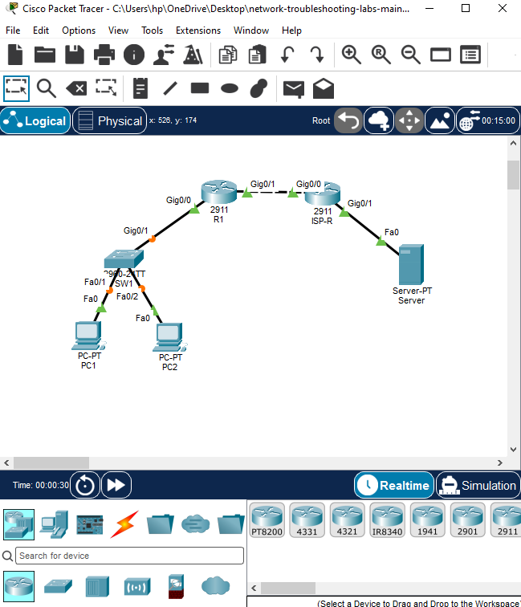

# Network Troubleshooting Labs

A collection of simulated network incidents, documented as support tickets.
Each ticket starts from a user-reported symptom, follows a structured
troubleshooting process, and ends with a verified fix.

Labs are built in **Cisco Packet Tracer**, with traffic captured in **Wireshark** where useful.

## Troubleshooting Method

I work **bottom-up through the OSI model**, ruling out one layer at a time:

1. **Physical** – cables, link lights, interface status
2. **Data Link** – VLANs, switch ports, ARP
3. **Network** – IP addressing, subnet masks, gateway, DHCP, routing
4. **Transport / Application** – DNS, ACLs, services

The goal is to find the root cause with evidence, not to guess a fix.

## Base Topology



| Device | Role | Address |
|--------|------|---------|
| R1 | Gateway + DHCP server | 192.168.1.1/24 |
| SW1 | Access switch | — |
| PC1, PC2 | Clients | DHCP |
| ISP-R | Simulated internet | 203.0.113.1 |

The base lab file is in [`topology/base-lab.pkt`](topology/).

## Tickets

| Ticket | Title | Layer | Key Tools | Status |
|--------|-------|-------|-----------|--------|
| [TKT-001](tickets/TKT-001-cable-fault/) | Workstation has no network connection | 1 | `show interfaces status` | ⬜ Planned |
| [TKT-002](tickets/TKT-002-wrong-vlan/) | One PC cannot reach the network | 2 | `show vlan brief` | ⬜ Planned |
| [TKT-003](tickets/TKT-003-gateway-interface-down/) | All users have no internet, router GUI unreachable | 2–3 | `arp -a`, `show ip interface brief` | ⬜ Planned |
| [TKT-004](tickets/TKT-004-dhcp-failure/) | Clients receive 169.254.x.x addresses | 3 | `ipconfig`, `show ip dhcp binding`, Wireshark | ⬜ Planned |
| [TKT-005](tickets/TKT-005-wrong-gateway/) | User can reach local devices but not the internet | 3 | `ipconfig`, `ping` | ⬜ Planned |
| [TKT-006](tickets/TKT-006-subnet-mask/) | Some devices reachable, others not | 3 | `ipconfig`, `ping` | ⬜ Planned |
| [TKT-007](tickets/TKT-007-duplicate-ip/) | Intermittent connectivity on one workstation | 3 | `arp -a`, logs | ⬜ Planned |
| [TKT-008](tickets/TKT-008-missing-route/) | Gateway reachable, internet unreachable | 3 | `show ip route`, `tracert` | ⬜ Planned |
| [TKT-009](tickets/TKT-009-dns-failure/) | Websites don't load, but ping by IP works | 7 | `nslookup`, Wireshark | ⬜ Planned |
| [TKT-010](tickets/TKT-010-acl-block/) | Ping fails but web browsing works | 3–4 | `show access-lists` | ⬜ Planned |

Status: ⬜ Planned · 🟨 In progress · ✅ Resolved & documented

## Repository Structure

```
topology/        Base lab file and diagram
tickets/         One folder per ticket (write-up, lab file, screenshots, captures)
templates/       Ticket template used for every write-up
```

## Skills Demonstrated

- Structured, layer-by-layer troubleshooting
- Cisco IOS show/debug commands
- DHCP, ARP, VLAN, routing, DNS and ACL diagnosis
- Packet analysis with Wireshark
- Clear technical documentation of incidents

## Related Projects

- [Packet Analysis Write-ups](https://github.com/YOUR-USERNAME/packet-analysis-writeups)
- [Homelab Network](https://github.com/YOUR-USERNAME/homelab-network)

---
*Author: Meryem Naddam — Computer Programming (Co-op), Algonquin College*
