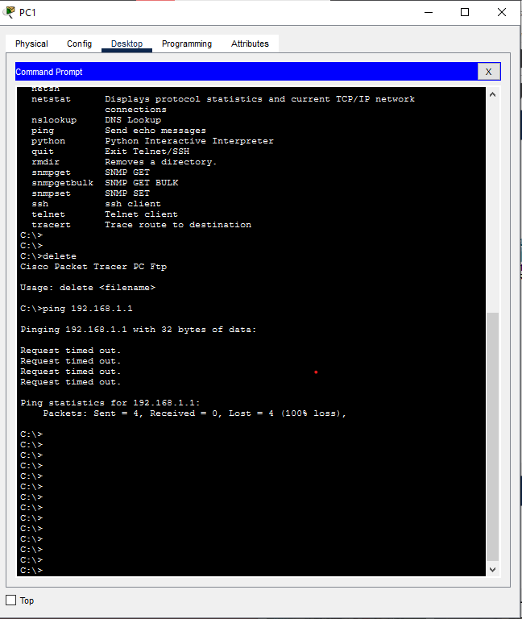
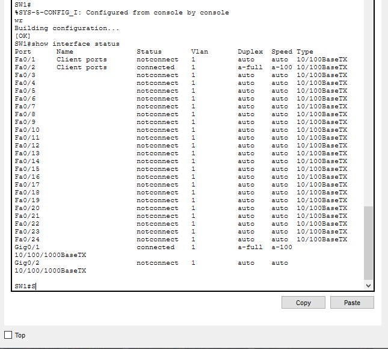
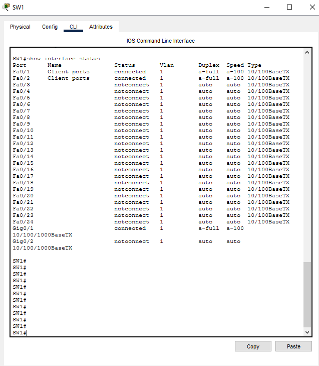

# TKT-001: Workstation Has No Network Connection

| Field | Value |
|-------|-------|
| **Reported by** | User at PC1 |
| **Priority** | Medium |
| **Affected** | One user (PC1) |
| **Layer** | 1 – Physical |
| **Status** | ✅ Resolved |

## 1. Reported Issue

> "My computer has no internet. Websites won't load and I can't reach anything on the network."

## 2. Initial Observations

- PC1 has no network access; PC2 on the same switch works normally.
- Since only one device is affected, the problem is likely local to PC1 or its connection, not the router or the internet link.

## 3. Troubleshooting Steps

| # | Action / Command | Result | Conclusion |
|---|------------------|--------|------------|
| 1 | `ipconfig` on PC1 | APIPA address `169.254.x.x`, no default gateway | DHCP failed — PC1 cannot reach the DHCP server on R1 |
| 2 | `ping 192.168.1.1` from PC1 | Failed | No connectivity to the gateway |
| 3 | `ipconfig` + `ping 192.168.1.1` from PC2 | Valid `192.168.1.x` address, ping successful | R1, DHCP and SW1 are working — issue is isolated to PC1 |
| 4 | Checked physical link (topology view) | Link indicator down / no cable on PC1 | Points to a Layer 1 problem |
| 5 | `show interfaces status` on SW1 | Fa0/1 `notconnect`, Fa0/2 `connected` | Confirms PC1's switch port has no physical link |

**PC1 – `ipconfig`:**

```
<!-- Paste your real PC1 ipconfig output here -->
FastEthernet0 Connection:(default port)

   Link-local IPv6 Address.........: ::
   IPv4 Address....................: 169.254.x.x
   Subnet Mask.....................: 255.255.0.0
   Default Gateway.................: 0.0.0.0
```

**SW1 – `show interfaces status`:**

```
<!-- Paste your real SW1 output here -->
Port      Name               Status       Vlan       Duplex  Speed Type
Fa0/1     Client ports       notconnect   1          auto    auto  10/100BaseTX
Fa0/2     Client ports       connected    1          a-full  a-100 10/100BaseTX
```





## 4. Root Cause

The network cable between **PC1** and **SW1 port Fa0/1** was disconnected.
With no physical link, PC1 could not send DHCP requests, fell back to an
APIPA (`169.254.x.x`) address, and had no path to the gateway.

## 5. Resolution

Reconnected PC1 to SW1 Fa0/1 using a **copper straight-through** cable,
then renewed the IP address on PC1 (IP Configuration → Static → DHCP).

No configuration changes were required on any device.

## 6. Verification

| Test | Result |
|------|--------|
| `ipconfig` on PC1 | Valid `192.168.1.x` address, gateway `192.168.1.1` ✅ |
| `ping 192.168.1.1` | Successful ✅ |
| `ping 198.51.100.10` (server) | Successful ✅ |
| Browser → `http://www.lab.local` | Page loads ✅ |
| `show interfaces status` on SW1 | Fa0/1 `connected` ✅ |



## 7. Lessons Learned

- **How to recognize it:** A `169.254.x.x` address combined with a `notconnect`
  switch port points to a physical problem, not a DHCP misconfiguration.
- **Isolate first:** Comparing with a working device on the same switch (PC2)
  quickly ruled out the router, DHCP server and internet link.
- **About cable types:** I first tried causing the fault with a crossover cable
  between PC1 and SW1, but the link still came up. Modern switches (and Packet
  Tracer) support **auto-MDIX**, which detects the cable type and adjusts
  automatically. On today's networks, a wrong cable type rarely causes an
  outage; unplugged, damaged or wrongly patched cables are far more common.
- **Prevention:** Label cables and switch ports, and check link lights first
  when a single user reports no connectivity.

## Files

- [`lab-broken.pkt`](lab-broken.pkt) – lab with PC1 disconnected
- 
- [`lab-fixed.pkt`](lab-fixed.pkt) – lab after the fix
- 
- [`screenshots/`](screenshots/) – symptom, diagnosis and verification evidence
