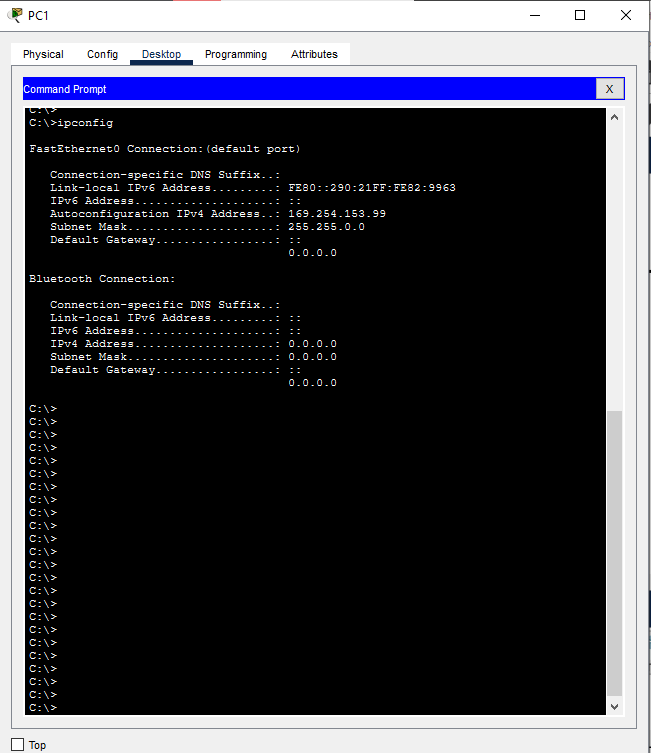
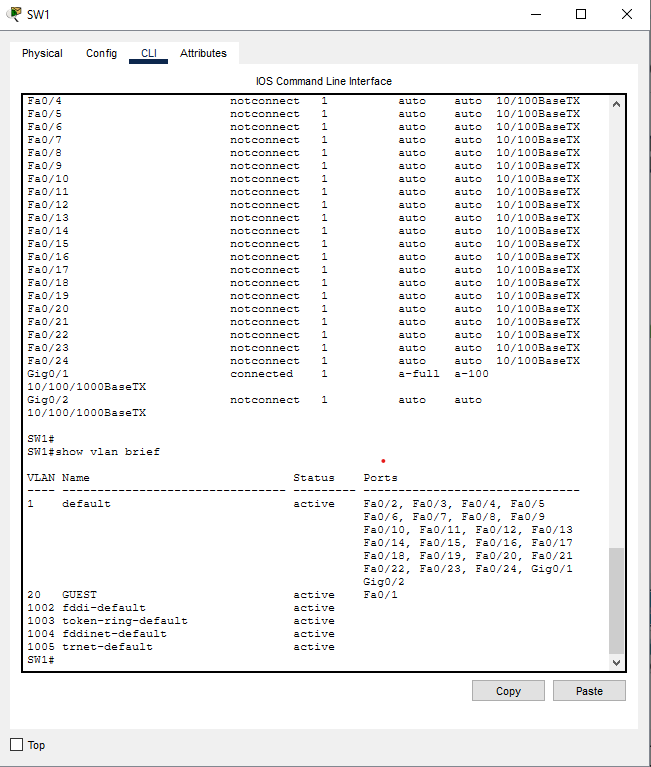
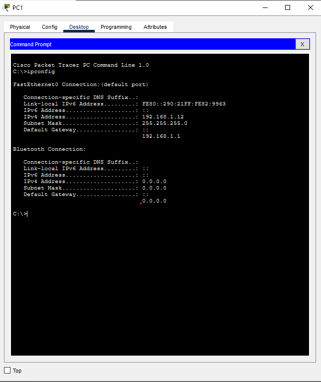

# TKT-002: One PC Cannot Reach the Network

| Field | Value |
|-------|-------|
| **Reported by** | User at PC1 |
| **Priority** | Medium |
| **Affected** | One user (PC1) |
| **Layer** | 2 – Data Link |
| **Status** | ✅ Resolved |

## 1. Reported Issue

> "My computer has no internet, but the cable is plugged in and the light is on."

## 2. Initial Observations

- PC1 has no network access; PC2 on the same switch works normally.
- The link lights between PC1 and SW1 are **green**, so the physical
  connection appears healthy — unlike [TKT-001](../TKT-001-unplugged-cable/).

## 3. Troubleshooting Steps

| # | Action / Command | Result | Conclusion |
|---|------------------|--------|------------|
| 1 | `ipconfig` on PC1 | APIPA address `169.254.x.x` | DHCP failed — PC1 cannot reach the DHCP server on R1 |
| 2 | `ping 192.168.1.1` from PC1 | Failed | No connectivity to the gateway |
| 3 | Checked physical link | Link up (green) on both ends | Layer 1 is fine — move up to Layer 2 |
| 4 | Tested PC2 | Valid address, ping successful | R1 and DHCP work — issue isolated to PC1's switch port |
| 5 | `show interfaces status` on SW1 | Fa0/1 `connected` but in **VLAN 20**; Fa0/2 in VLAN 1 | PC1's port is in a different VLAN from the gateway |
| 6 | `show vlan brief` on SW1 | Fa0/1 listed under VLAN 20 (GUEST) | Confirms the VLAN misassignment |

**PC1 – `ipconfig`:**

```
<!-- Paste your real PC1 ipconfig output here -->
FastEthernet0 Connection:(default port)

   IPv4 Address....................: 169.254.x.x
   Subnet Mask.....................: 255.255.0.0
   Default Gateway.................: 0.0.0.0
```

**SW1 – `show vlan brief`:**

```
<!-- Paste your real SW1 output here -->
VLAN Name                             Status    Ports
---- -------------------------------- --------- -------------------------------
1    default                          active    Fa0/2, Fa0/3, Fa0/4, ...
20   GUEST                            active    Fa0/1
```




## 4. Root Cause

Switch port **Fa0/1** on SW1 (connected to PC1) was assigned to **VLAN 20**,
while the router R1 and the DHCP server are reachable only through **VLAN 1**.
Because VLANs are separate broadcast domains, PC1's DHCP Discover broadcasts
never reached R1, so PC1 fell back to an APIPA address.

## 5. Resolution

Reassigned Fa0/1 to the correct VLAN on SW1:

```
conf t
interface fa0/1
 switchport access vlan 1
end
write memory
```

Then renewed the IP address on PC1 (IP Configuration → Static → DHCP).

## 6. Verification

| Test | Result |
|------|--------|
| `ipconfig` on PC1 | Valid `192.168.1.x` address, gateway `192.168.1.1` ✅ |
| `ping 192.168.1.1` | Successful ✅ |
| `ping 198.51.100.10` (server) | Successful ✅ |
| Browser → `http://www.lab.local` | Page loads ✅ |
| `show vlan brief` on SW1 | Fa0/1 back in VLAN 1 ✅ |



## 7. Lessons Learned

- **How to recognize it:** A `169.254.x.x` address with a **green link light**
  points beyond Layer 1 — check the switch port's VLAN next.
- **How it differs from TKT-001:** Both show APIPA and a failed gateway ping,
  but in TKT-001 the port was `notconnect`; here it is `connected` in the wrong VLAN.
- **Key commands:** `show vlan brief` and `show interfaces status` show port-to-VLAN
  assignments at a glance.
- **Prevention:** Document which VLAN each port belongs to, use port descriptions,
  and verify VLAN assignments after any switch change.

## Files

- [`lab-broken.pkt`](lab-broken.pkt) – lab with Fa0/1 in VLAN 20
- [`lab-fixed.pkt`](lab-fixed.pkt) – lab after the fix
- [`screenshots/`](screenshots/) – symptom, diagnosis and verification evidence
