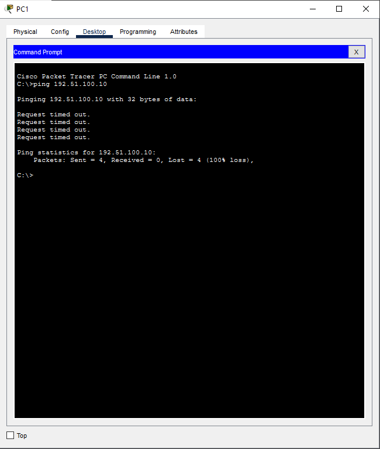
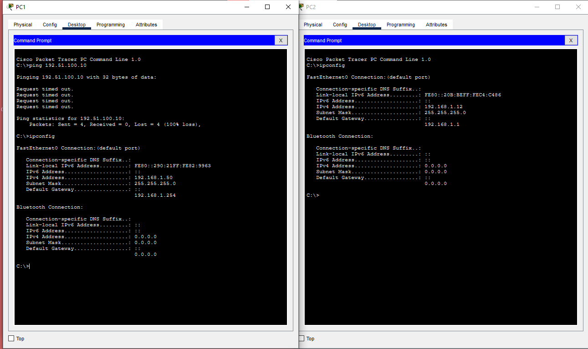
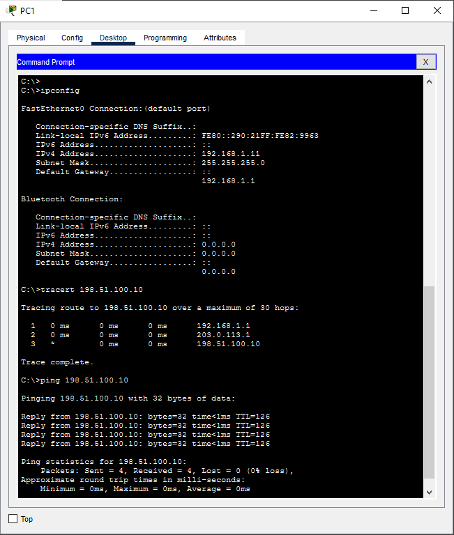

# TKT-005: User Can Reach Local Devices but Not the Internet

| Field | Value |
|-------|-------|
| **Reported by** | User at PC1 |
| **Priority** | Medium |
| **Affected** | One user (PC1) |
| **Layer** | 3 – Network (host configuration) |
| **Status** | ✅ Resolved |

## 1. Reported Issue

> "I can reach the other computers in the office, but websites won't load."

## 2. Initial Observations

- Only PC1 is affected; PC2 browses normally.
- PC1 can communicate locally, so Layers 1–2 are working. The problem is with
  reaching **other networks**, which points to the default gateway or routing.

## 3. Troubleshooting Steps

| # | Action / Command | Result | Conclusion |
|---|------------------|--------|------------|
| 1 | `ping 198.51.100.10` from PC1 | Failed | No access outside the LAN |
| 2 | `ping` PC2 from PC1 | Successful | Local LAN works |
| 3 | `ping 192.168.1.1` from PC1 | Successful | R1 is up and reachable — so why isn't traffic leaving? |
| 4 | `tracert 198.51.100.10` from PC1 | Fails at hop 1 | Packets never reach a router |
| 5 | `ipconfig /all` on PC1 vs PC2 | PC1 gateway `192.168.1.254`; PC2 gateway `192.168.1.1` | PC1 is sending off-network traffic to a gateway that doesn't exist |
| 6 | `arp -a` on PC1 | No entry for `192.168.1.254` | Nothing answers at that address |

**PC1 – `ping 198.51.100.10`:**

```
<!-- Paste your real ping output here -->
```

**PC1 – `tracert 198.51.100.10`:**

```
<!-- Paste your real tracert output here -->
```

**PC1 – `ipconfig /all`:**

```
<!-- Paste your real PC1 output here -->
```




## 4. Root Cause

PC1 had been manually configured with a static IP and an incorrect default
gateway (`192.168.1.254`) instead of the router's address (`192.168.1.1`).
Traffic to the local subnet is delivered directly and worked, but all traffic
to other networks was sent to a gateway that does not exist, so it was dropped.

## 5. Resolution

Set PC1's IP configuration back to **DHCP** so it receives the correct gateway
automatically, rather than only correcting the static gateway. The static
address `192.168.1.50` also falls inside the DHCP pool and could later
cause an IP conflict.

## 6. Verification

| Test | Result |
|------|--------|
| `ipconfig` on PC1 | DHCP address, gateway `192.168.1.1` ✅ |
| `ping 198.51.100.10` | Successful ✅ |
| `tracert 198.51.100.10` | Path via `192.168.1.1` → `203.0.113.1` → server ✅ |
| Browser → `http://www.lab.local` | Page loads ✅ |



## 7. Lessons Learned

- **Local works, remote fails → check the gateway.** A host only uses its default
  gateway for traffic leaving its own subnet.
- **A reachable router doesn't prove the gateway is right.** Pinging
  `192.168.1.1` succeeded because it is on the same subnet, yet PC1 was configured
  to use a different address as its gateway.
- **`tracert` pinpoints where traffic stops.** Failing at hop 1 means the packet
  never reached a router.
- **Compare with a working host.** Putting PC1's and PC2's `ipconfig /all` side
  by side made the difference obvious.
- **Prevention:** Use DHCP for client devices, and keep static addresses for
  infrastructure, outside the DHCP range.

## Files

- [`lab-broken.pkt`](lab-broken.pkt) – lab with PC1's wrong gateway
- [`lab-fixed.pkt`](lab-fixed.pkt) – lab after the fix
- [`screenshots/`](screenshots/) – symptom, diagnosis and verification evidence
