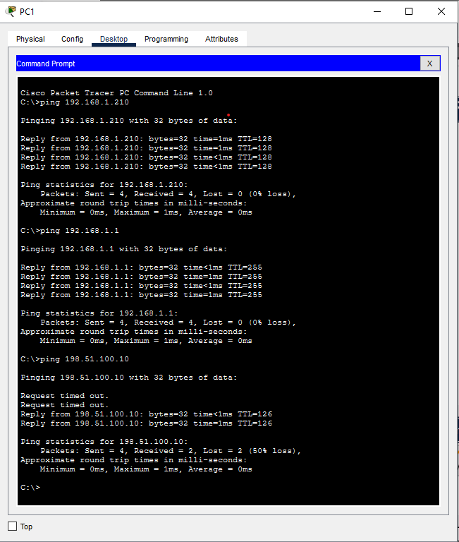
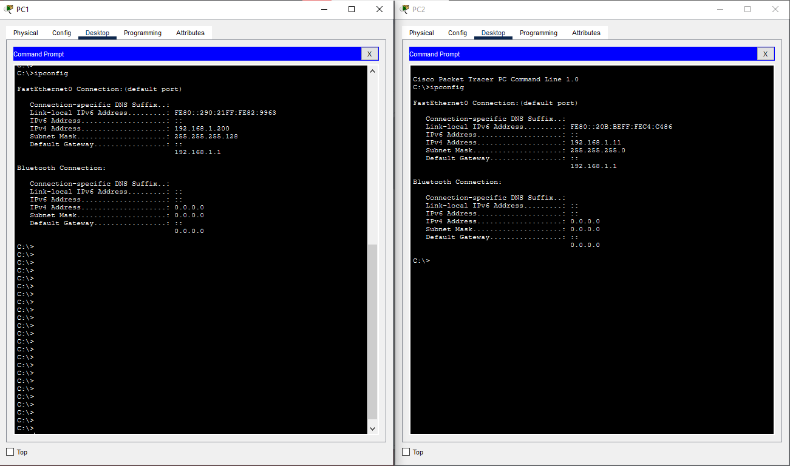

# TKT-006: Some Devices Reachable, Others Not

| Field | Value |
|-------|-------|
| **Reported by** | User at PC1 |
| **Priority** | Medium |
| **Affected** | One user (PC1) |
| **Layer** | 3 – Network (host configuration) |
| **Status** | ✅ Resolved |

## 1. Reported Issue

> "I can still print, but I have no internet and I can't reach my coworker's computer."

## 2. Initial Observations

- Only PC1 is affected; PC2 works normally.
- PC1 can reach **some** local devices but not others, which rules out a
  simple physical or VLAN problem (those would block everything).
- Partial reachability on the same LAN suggests an addressing issue on PC1.

## Lab Note

For this ticket, a network printer (`192.168.1.210/24`) was added to SW1 Fa0/3.

## 3. Troubleshooting Steps

| # | Action / Command | Result | Conclusion |
|---|------------------|--------|------------|
| 1 | `ping 192.168.1.210` (printer) from PC1 | Successful | Physical link and switch work |
| 2 | `ping` PC2 from PC1 | Failed | Some local hosts unreachable |
| 3 | `ping 192.168.1.1` (gateway) from PC1 | Failed | Gateway unreachable |
| 4 | `ping 198.51.100.10` (server) from PC1 | Failed | No internet access |
| 5 | `ipconfig` on PC1 vs PC2 | PC1 mask `255.255.255.128` (/25); PC2 mask `255.255.255.0` (/24) | PC1 has the wrong subnet mask |
| 6 | Subnet calculation for `192.168.1.200/25` | Network `192.168.1.128`, hosts `.129–.254` | Printer (`.210`) is inside PC1's subnet; PC2 (`.11`) and the gateway (`.1`) are not |

**PC1 – ping results:**

```
<!-- Paste your real ping outputs here (printer, PC2, gateway, server) -->
```

**PC1 – `ipconfig`:**

```
<!-- Paste your real PC1 output here -->
```




## 4. Root Cause

PC1 was manually configured with the subnet mask `255.255.255.128` (/25)
instead of `255.255.255.0` (/24). With a /25 mask, PC1 believed its local network
was only `192.168.1.128–255`:

| Destination | In PC1's /25? | PC1's decision | Result |
|-------------|---------------|----------------|--------|
| Printer `.210` | Yes | Deliver directly | ✅ Works |
| PC2 `.11` | No | Send to gateway | ❌ Fails |
| Gateway `.1` | No | Gateway is outside its own subnet | ❌ Fails |
| Server `198.51.100.10` | No | Send to gateway | ❌ Fails |

Because the configured gateway (`192.168.1.1`) was outside PC1's own subnet,
PC1 had no usable path to anything beyond its /25 range.

## 5. Resolution

Set PC1's IP configuration back to **DHCP**, which provides the correct
mask (`255.255.255.0`), gateway and DNS automatically.

## 6. Verification

| Test | Result |
|------|--------|
| `ipconfig` on PC1 | Mask `255.255.255.0`, gateway `192.168.1.1` ✅ |
| `ping` printer, PC2 and gateway | Successful ✅ |
| `ping 198.51.100.10` | Successful ✅ |
| Browser → `http://www.lab.local` | Page loads ✅ |


## 7. Lessons Learned

- **"Some work, some don't" on the same LAN → check the mask.** Physical and VLAN
  problems usually block everything; a wrong mask splits the network unpredictably.
- **Do the subnet math.** Calculating the network range from the IP and mask
  immediately explained which hosts worked and which didn't.
- **The gateway must be inside the host's subnet.** Otherwise the host cannot
  reach it, and all off-network traffic fails.
- **Compare with a working host.** PC2's `/24` mask made PC1's `/25` stand out.
- **Prevention:** Use DHCP for clients. Give static devices (like printers)
  addresses outside the DHCP pool, and double-check masks when configuring them.

## Files

- [`lab-broken.pkt`](lab-broken.pkt) – lab with PC1's wrong subnet mask
- [`lab-fixed.pkt`](lab-fixed.pkt) – lab after the fix
- [`screenshots/`](screenshots/) – symptom, diagnosis and verification evidence
