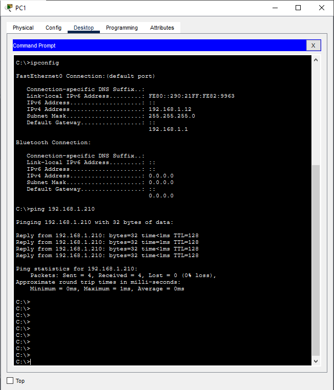

# TKT-004: Clients Cannot Get an IP Address

| Field | Value |
|-------|-------|
| **Reported by** | Multiple users (PC1, PC2) |
| **Priority** | High |
| **Affected** | All clients that renew or join the network |
| **Layer** | 7 – Application (DHCP service) |
| **Status** | ✅ Resolved |

## 1. Reported Issue

> "Since the router maintenance this afternoon, computers that restart can't connect to the network."

## 2. Initial Observations

- Both PCs show no IPv4 address (`0.0.0.0`) after renewing.
- Link lights are green and both switch ports are in VLAN 1, which rules out the
  physical and VLAN issues seen in [TKT-001](../TKT-001-unplugged-cable/) and
  [TKT-002](../TKT-002-wrong-vlan/).
- The issue started after a change on the router, so recent configuration is a suspect.

## 3. Troubleshooting Steps

| # | Action / Command | Result | Conclusion |
|---|------------------|--------|------------|
| 1 | `ipconfig` on PC1 and PC2 | IPv4 `0.0.0.0`, no gateway | DHCP is failing for all clients |
| 2 | Checked link lights, `show vlan brief` on SW1 | Links up, ports in VLAN 1 | Layers 1–2 are fine |
| 3 | Set a **temporary static IP** on PC1 (`192.168.1.50/24`, gw `192.168.1.1`) and pinged the gateway | Successful | The network path works — the fault is in the DHCP service itself |
| 4 | `show ip dhcp binding` on R1 | No bindings | R1 is not leasing any addresses |
| 5 | `show ip dhcp pool` on R1 | Leased addresses: 0 | Pool exists but hands out nothing |
| 6 | `show running-config \| include dhcp` on R1 | `ip dhcp excluded-address 192.168.1.11 192.168.1.254` | The excluded range covers the **entire** usable pool |
| 7 | Simulation mode, DHCP filter | DHCP Discover sent, no Offer returned | Confirms the server receives requests but cannot offer an address |

**PC1 – `ipconfig`:**

```
<!-- Paste your real PC1 ipconfig output here -->
```

**PC1 – ping with temporary static IP:**

```
<!-- Paste your real ping output here -->
```

**R1 – `show ip dhcp pool`:**

```
<!-- Paste your real R1 output here -->
```

**R1 – `show running-config | include dhcp`:**

```
<!-- Paste your real R1 output here -->
ip dhcp excluded-address 192.168.1.1 192.168.1.10
ip dhcp excluded-address 192.168.1.11 192.168.1.254
ip dhcp pool LAN
```


## 4. Root Cause

During maintenance, an extra `ip dhcp excluded-address 192.168.1.11 192.168.1.254`
line was added on R1. Combined with the existing exclusion (`.1–.10`), every
address in the `192.168.1.0/24` pool was excluded. The DHCP server received
client requests but had no addresses to offer, so clients were left without an IP.

## 5. Resolution

Removed the incorrect exclusion:

```
conf t
no ip dhcp excluded-address 192.168.1.11 192.168.1.254
end
write memory
```

Set PC1 back to DHCP and renewed the address on both PCs.

## 6. Verification

| Test | Result |
|------|--------|
| `ipconfig` on PC1 and PC2 | Valid `192.168.1.x` addresses ✅ |
| `show ip dhcp binding` on R1 | Both clients' MAC addresses listed ✅ |
| `ping 192.168.1.1` and `ping 198.51.100.10` | Successful ✅ |
| Browser → `http://www.lab.local` | Page loads ✅ |



## 7. Lessons Learned

- **Static IP test:** Giving a client a temporary static address separates a
  *network path* problem from a *DHCP service* problem in one step.
  (Always set it back to DHCP afterwards.)
- **DHCP can "run" and still fail:** The pool existed and the service was on,
  but exclusions left nothing to lease. `show ip dhcp binding` and
  `show ip dhcp pool` show what's actually being handed out.
- **Check recent changes:** "It broke after maintenance" is a strong clue —
  compare the running config with the [baseline](../../topology/baseline.txt).
- **Existing leases hide the problem:** Clients that already had an address kept
  working until they renewed, so DHCP failures often appear gradually.
- **Prevention:** Review DHCP exclusions after changes, and keep a known-good
  config backup to compare against.

## Files

- [`lab-broken.pkt`](lab-broken.pkt) – lab with the whole DHCP range excluded
- [`lab-fixed.pkt`](lab-fixed.pkt) – lab after the fix
- [`screenshots/`](screenshots/) – symptom, diagnosis and verification evidence
