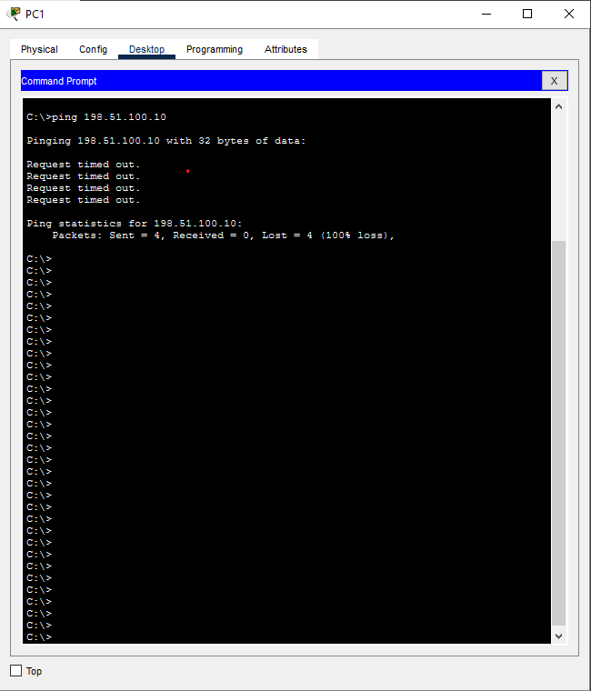
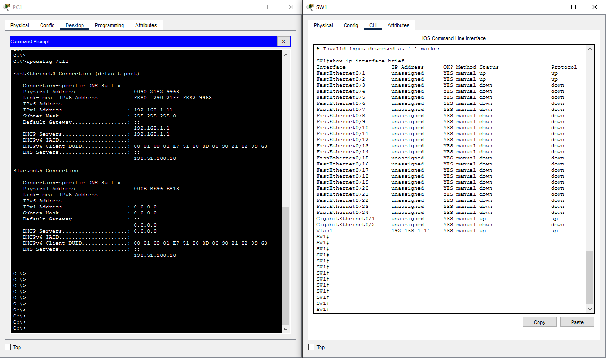
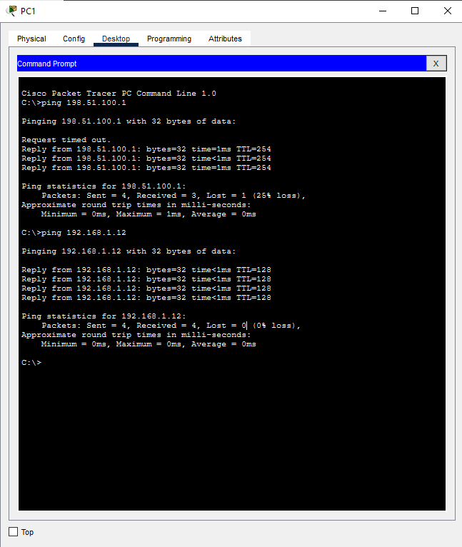

# TKT-007: Intermittent Connectivity on One Workstation

| Field | Value |
|-------|-------|
| **Reported by** | User at PC1 |
| **Priority** | Medium |
| **Affected** | PC1 |
| **Layer** | 3 – Network (addressing), visible at Layer 2 (ARP) |
| **Status** | ✅ Resolved |

## 1. Reported Issue

> "My internet keeps cutting in and out since this morning. Sometimes it works, sometimes it doesn't."

## 2. Initial Observations

- PC1's connection is **intermittent**, not completely down.
- That morning, the network admin configured a management IP on the switch (SW1).
- Intermittent problems on one address, starting right after a change, are a
  classic sign of an IP address conflict.

## 3. Troubleshooting Steps

| # | Action / Command | Result | Conclusion |
|---|------------------|--------|------------|
| 1 | `ping 198.51.100.10` from PC1 | Successful | Connection works at first |
| 2 | SW1 sends traffic (`ping 192.168.1.1`) | — | SW1's management interface becomes active |
| 3 | `ping 198.51.100.10` from PC1 again | Failed / timed out | Connectivity drops after SW1 is active |
| 4 | `show ip arp` on R1 | `192.168.1.11` mapped to a MAC that is **not PC1's** | R1 sends PC1's replies to another device |
| 5 | `ipconfig /all` on PC1 | PC1's MAC differs from R1's ARP entry | Another device is using PC1's IP |
| 6 | `show ip interface brief` and `show interfaces vlan 1` on SW1 | Vlan1 = `192.168.1.11`, MAC matches R1's ARP entry | SW1's management IP duplicates PC1's DHCP address |

**R1 – `show ip arp`:**

```
<!-- Paste your real R1 output here -->
```

**PC1 – `ipconfig /all` (IP and MAC):**

```
<!-- Paste the relevant lines here -->
```

**SW1 – `show ip interface brief` / `show interfaces vlan 1`:**

```
<!-- Paste your real SW1 output here -->
```




## 4. Root Cause

SW1's management interface (VLAN 1 SVI) was configured with the static IP
`192.168.1.11`, which the DHCP server had already leased to PC1. Both devices
answered for the same address.

Each time one of them sent traffic, R1 updated its ARP table to map
`192.168.1.11` to that device's MAC address. While the entry pointed to SW1,
replies meant for PC1 were delivered to the switch instead, so PC1's
connection kept working and failing.

## 5. Resolution

Moved SW1's management IP to an address in the excluded (infrastructure) range
and set its default gateway:

```
conf t
interface vlan 1
 ip address 192.168.1.2 255.255.255.0
exit
ip default-gateway 192.168.1.1
end
write memory
```

Then cleared R1's ARP cache so the correct mapping was learned again:

```
clear arp-cache
```

## 6. Verification

| Test | Result |
|------|--------|
| `show ip interface brief` on SW1 | Vlan1 = `192.168.1.2` ✅ |
| `show ip arp` on R1 | `192.168.1.11` mapped to PC1's MAC ✅ |
| Repeated pings from PC1 to the server | Consistently successful ✅ |
| `ping 192.168.1.2` from PC1 | Switch management reachable ✅ |
| Browser → `http://www.lab.local` on PC1 | Page loads ✅ |



## 7. Lessons Learned

- **Intermittent + recent change = suspect a duplicate IP.** Conflicts rarely cause
  a clean outage; they cause connections that come and go.
- **Follow the MAC address.** The ARP table shows which MAC owns an IP *right now*.
  Comparing it with each device's MAC identified the conflicting device.
- **Conflicts aren't only between PCs.** Infrastructure devices (switches,
  printers, access points) with manually set IPs are a common source.
- **Hosts often detect conflicts themselves.** When I first tried to give a second
  PC the same static IP, Packet Tracer refused with *"This address is already used
  in the network"*, much like Windows' IP conflict warning. Devices configured from
  the CLI, like the switch here, don't get that check, so the conflict went unnoticed.
- **Prevention:** Reserve a range for infrastructure (here `.1–.10`, already excluded
  from DHCP), document every static IP, and never assign static addresses inside the DHCP pool.

## Files

- [`lab-broken.pkt`](lab-broken.pkt) – lab with SW1's management IP duplicating PC1
- [`lab-fixed.pkt`](lab-fixed.pkt) – lab after the fix
- [`screenshots/`](screenshots/) – symptom, diagnosis and verification evidence
