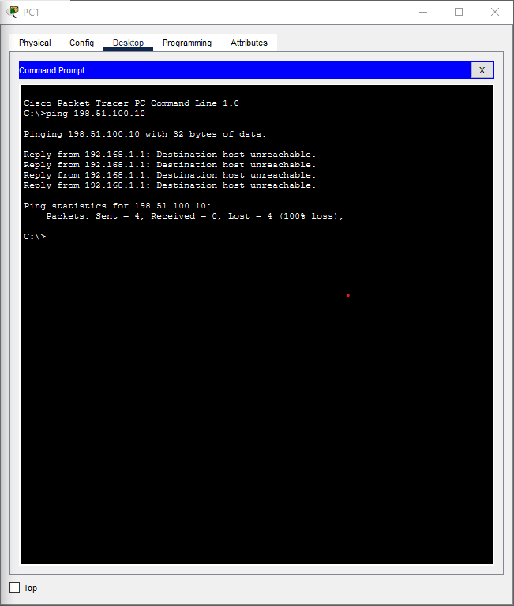
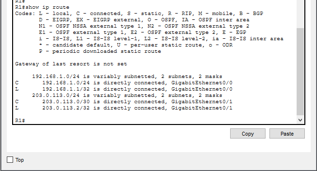
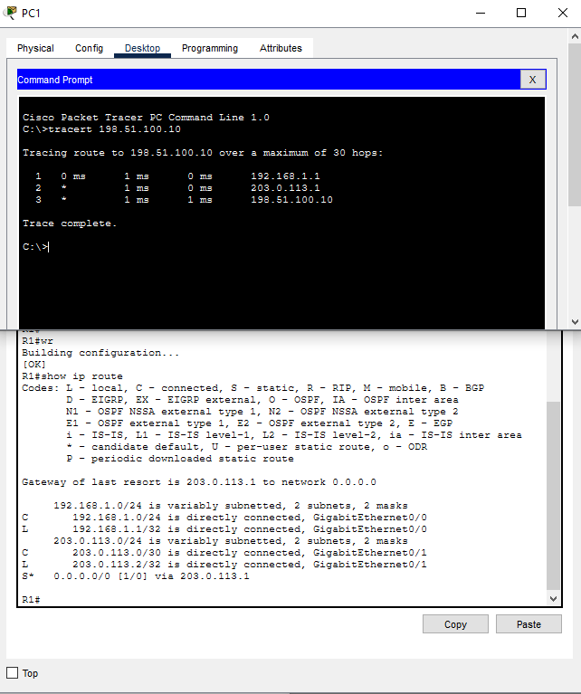

# TKT-008: Gateway Reachable, Internet Unreachable

| Field | Value |
|-------|-------|
| **Reported by** | Multiple users (PC1, PC2) |
| **Priority** | Critical |
| **Affected** | Entire site |
| **Layer** | 3 – Network (routing) |
| **Status** | ✅ Resolved |

## 1. Reported Issue

> "The whole office lost internet right after this morning's WAN maintenance."

## 2. Initial Observations

- **All** users are affected, so the cause is a shared device or link.
- Unlike [TKT-003](../TKT-003-gateway-interface-down/), clients can still reach
  the gateway, so the LAN side of R1 is working.
- The outage began right after a change on the WAN side.

## 3. Troubleshooting Steps

| # | Action / Command | Result | Conclusion |
|---|------------------|--------|------------|
| 1 | `ping 198.51.100.10` from PC1 | Failed — reply from `192.168.1.1`: destination unreachable | R1 itself reports it cannot forward the packet |
| 2 | Same test from PC2 | Same failure | All users affected — shared cause |
| 3 | `ping 192.168.1.1` from PC1 | Successful | LAN and gateway interface are fine |
| 4 | `ping 203.0.113.1` (ISP router) from PC1 | Successful | WAN link is up; the directly connected network still works |
| 5 | `tracert 198.51.100.10` from PC1 | Hop 1 = `192.168.1.1`, then stops | Traffic dies at R1 |
| 6 | `show ip route` on R1 | "Gateway of last resort is not set", no `S*` route | R1 has no route to destinations beyond its connected networks |
| 7 | Compared with [`baseline.txt`](../../topology/baseline.txt) | Default route present in baseline, missing now | The default route was removed during maintenance |

**PC1 – `ping 198.51.100.10`:**

```
<!-- Paste your real ping output here -->
```

**PC1 – `tracert 198.51.100.10`:**

```
<!-- Paste your real tracert output here -->
```

**R1 – `show ip route`:**

```
<!-- Paste your real R1 output here -->
```




## 4. Root Cause

The static default route on R1 (`ip route 0.0.0.0 0.0.0.0 203.0.113.1`) was
removed during WAN maintenance. Without it, R1 only knew about its directly
connected networks (`192.168.1.0/24` and `203.0.113.0/30`). Packets for any
other destination, including the server and DNS at `198.51.100.10`, had no
matching route, so R1 dropped them and returned ICMP "destination unreachable"
messages to the clients.

## 5. Resolution

Restored the default route on R1:

```
conf t
ip route 0.0.0.0 0.0.0.0 203.0.113.1
end
write memory
```

## 6. Verification

| Test | Result |
|------|--------|
| `show ip route` on R1 | `S* 0.0.0.0/0 [1/0] via 203.0.113.1`, gateway of last resort set ✅ |
| `tracert 198.51.100.10` | `192.168.1.1` → `203.0.113.1` → `198.51.100.10` ✅ |
| `ping 198.51.100.10` from PC1 and PC2 | Successful ✅ |
| Browser → `http://www.lab.local` | Page loads ✅ |



## 7. Lessons Learned

- **Gateway works, internet doesn't → check the router's routing table.**
  If clients reach the gateway, the LAN is fine; the problem is what the router
  does with traffic next.
- **Read who sends the error.** A "destination unreachable" reply *from the
  gateway's IP* means the router received the packet but had nowhere to send it.
- **Directly connected networks keep working.** The ISP router (`203.0.113.1`)
  was still reachable because R1 doesn't need a static route for its own links,
  which helped narrow the problem to routing, not the WAN link.
- **`tracert` shows where traffic stops.** Stopping right after hop 1 pointed at R1.
- **Baselines pay off.** Comparing the routing table with the saved baseline
  showed exactly what changed.
- **Prevention:** Back up configurations before maintenance, compare after
  changes, and verify `show ip route` as part of every change checklist.

## Files

- [`lab-broken.pkt`](lab-broken.pkt) – lab with R1's default route removed
- [`lab-fixed.pkt`](lab-fixed.pkt) – lab after the fix
- [`screenshots/`](screenshots/) – symptom, diagnosis and verification evidence
