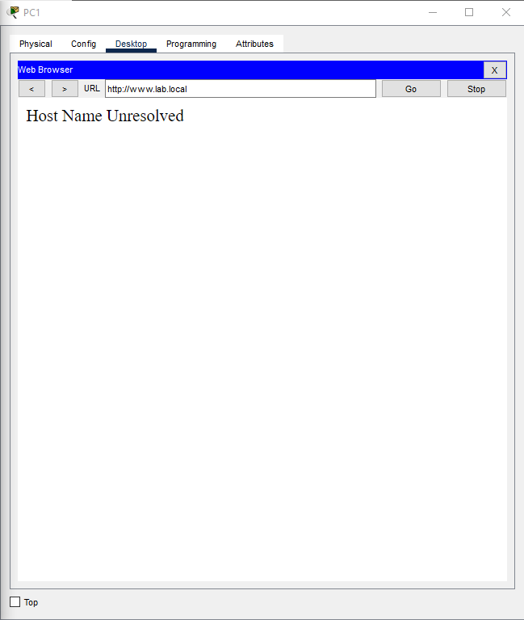
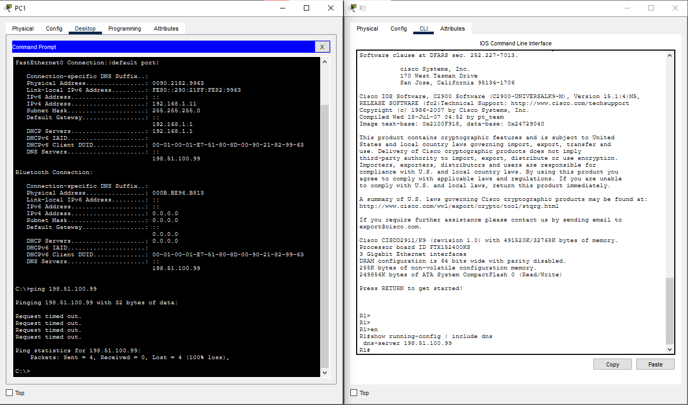
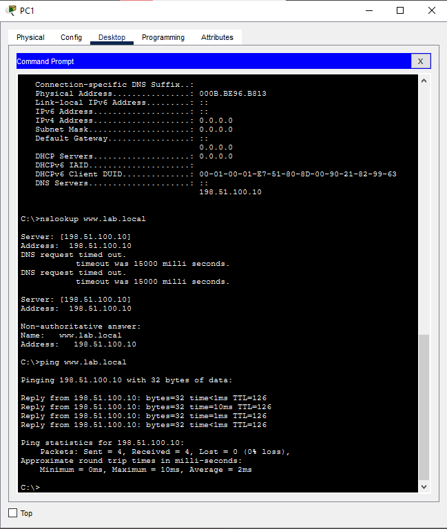

# TKT-009: Websites Don't Load, but Ping by IP Works

| Field | Value |
|-------|-------|
| **Reported by** | Multiple users (PC1, PC2) |
| **Priority** | High |
| **Affected** | All DHCP clients |
| **Layer** | 7 – Application (DNS) |
| **Status** | ✅ Resolved |

## 1. Reported Issue

> "The internet is down — no websites will load."

## 2. Initial Observations

- All clients are affected.
- Users report "no internet", but that only describes what they see in the browser.
  The first job is to test whether the **network** is actually down or only **name resolution**.

## 3. Troubleshooting Steps

| # | Action / Command | Result | Conclusion |
|---|------------------|--------|------------|
| 1 | Browser → `http://www.lab.local` on PC1 | "Host Name Unresolved" | Browser cannot turn the name into an IP |
| 2 | `ping www.lab.local` | Could not find host | Name resolution fails |
| 3 | `ping 198.51.100.10` | Successful | Routing and the path to the server work |
| 4 | Browser → `http://198.51.100.10` | Page loads | Web server works — **the problem is DNS** |
| 5 | `nslookup www.lab.local` | Fails; queried server `198.51.100.99` | Client is asking the wrong DNS server |
| 6 | `ipconfig /all` on PC1 | DNS server `198.51.100.99` (correct is `198.51.100.10`) | Wrong DNS setting on the client |
| 7 | `ping 198.51.100.99` | Failed | No DNS server exists at that address |
| 8 | `show running-config \| include dns` on R1 | `dns-server 198.51.100.99` | The wrong address is handed out by DHCP |

**PC1 – browser / `ping www.lab.local`:**

```
<!-- Paste your real output here -->
```

**PC1 – `nslookup www.lab.local`:**

```
<!-- Paste your real nslookup output here -->
```

**PC1 – `ipconfig /all` (DNS line):**

```
<!-- Paste your real output here -->
```

**R1 – `show running-config | include dns`:**

```
<!-- Paste your real R1 output here -->
```




## 4. Root Cause

The DHCP pool on R1 was configured with the wrong DNS server address
(`198.51.100.99` instead of `198.51.100.10`). Every client that renewed its lease
received this address, sent its DNS queries to a host that doesn't exist, and
could not resolve any names. Routing and the web server were working the whole time.

## 5. Resolution

Corrected the DNS server in the DHCP pool:

```
conf t
ip dhcp pool LAN
 dns-server 198.51.100.10
end
write memory
```

Renewed the IP configuration on both PCs to receive the corrected setting.

## 6. Verification

| Test | Result |
|------|--------|
| `ipconfig /all` on PC1 and PC2 | DNS server `198.51.100.10` ✅ |
| `nslookup www.lab.local` | Resolves to `198.51.100.10` ✅ |
| `ping www.lab.local` | Successful ✅ |
| Browser → `http://www.lab.local` | Page loads ✅ |



## 7. Lessons Learned

- **Ping by IP vs ping by name.** If the IP works and the name doesn't, it's DNS.
  This one test separates "network down" from "names down".
- **"No internet" is a symptom, not a diagnosis.** The network was healthy the
  whole time; only name resolution was broken.
- **`nslookup` shows which server is being asked**, which pointed straight to the
  wrong DNS address.
- **Follow the setting to its source.** The client wasn't misconfigured by hand;
  DHCP gave it the wrong value, so fixing the DHCP pool fixed every client.
- **Prevention:** Verify DHCP options (gateway, DNS) after any change, and consider
  a secondary DNS server so one failure doesn't stop name resolution.

## Files

- [`lab-broken.pkt`](lab-broken.pkt) – lab with the wrong DNS server in DHCP
- [`lab-fixed.pkt`](lab-fixed.pkt) – lab after the fix
- [`screenshots/`](screenshots/) – symptom, diagnosis and verification evidence
