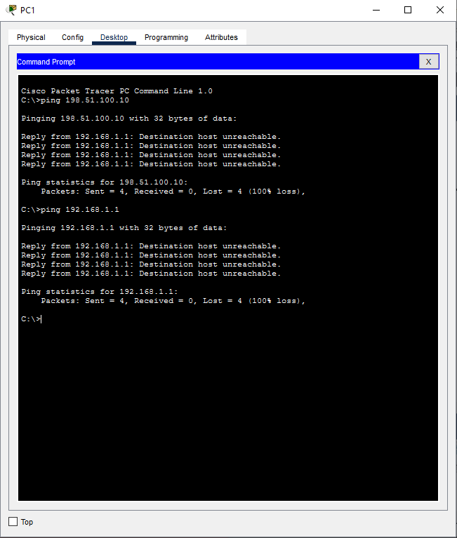
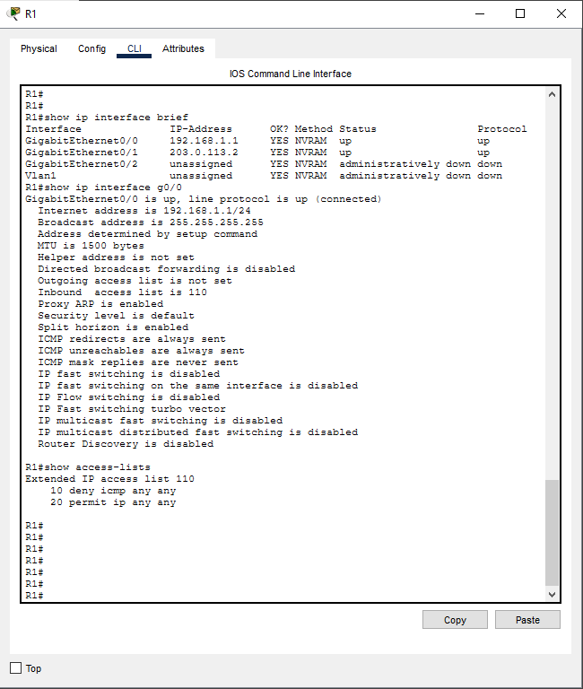
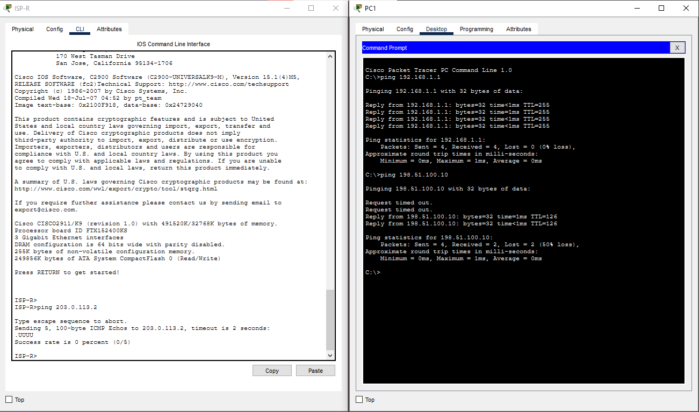

# TKT-010: Ping Fails but Web Browsing Works

| Field | Value |
|-------|-------|
| **Reported by** | Network monitoring / IT staff |
| **Priority** | Medium |
| **Affected** | All LAN clients (ICMP only) |
| **Layer** | 3–4 (ACL filtering) |
| **Status** | ✅ Resolved |

## 1. Reported Issue

> "Our monitoring shows the gateway and the server as down, but users say websites work fine."

## 2. Initial Observations

- Ping-based monitoring reports outages, yet users can browse normally.
- That morning, a security change was made to block pings from the internet.
- When different types of traffic behave differently, something is **filtering**
  traffic rather than the network being down.

## 3. Troubleshooting Steps

| # | Action / Command | Result | Conclusion |
|---|------------------|--------|------------|
| 1 | `ping 198.51.100.10` from PC1 | Failed | Server appears unreachable |
| 2 | `ping 192.168.1.1` from PC1 | Failed | Gateway appears unreachable — looks like [TKT-003](../TKT-003-gateway-interface-down/) |
| 3 | Browser → `http://www.lab.local` | Page loads | Network is up; only ICMP is affected |
| 4 | `arp -a` on PC1 | Gateway MAC present | Layer 2 to R1 is fine — not an interface outage |
| 5 | `tracert 198.51.100.10` | Failed | tracert also relies on ICMP |
| 6 | `show ip interface brief` on R1 | G0/0 `up / up` | Interface is healthy |
| 7 | `show ip interface g0/0` on R1 | "Inbound access list is 110" | An ACL filters traffic entering from the LAN |
| 8 | `show access-lists` on R1 | `deny icmp any any`, match count increasing with each ping | ACL 110 is dropping all ICMP from LAN users |

**PC1 – ping results:**

```
<!-- Paste your real ping outputs here -->
```

**R1 – `show ip interface g0/0` (ACL line):**

```
<!-- Paste the relevant lines here -->
```

**R1 – `show access-lists`:**

```
<!-- Paste your real R1 output here -->
```




## 4. Root Cause

The goal of the security change was to block pings **coming from the internet**.
Instead, ACL 110 (`deny icmp any any`) was applied **inbound on the LAN interface
G0/0**. This dropped every ICMP packet sent by internal users, including pings to
the gateway itself, while HTTP and DNS traffic was still permitted. Ping-based
monitoring therefore reported outages even though the network was working.

Two mistakes:
1. **Wrong interface/direction:** LAN inbound instead of WAN inbound.
2. **Too broad:** `deny icmp any any` blocks all ICMP, including echo-replies and
   error messages, not just incoming ping requests.

## 5. Resolution

Removed ACL 110 and implemented the intended policy: block ping requests
(`echo`) arriving from the internet on the WAN interface, while allowing replies
to internal users' traffic.

```
conf t
interface g0/0
 no ip access-group 110 in
exit
no access-list 110
access-list 120 deny icmp any any echo
access-list 120 permit ip any any
interface g0/1
 ip access-group 120 in
end
write memory
```

## 6. Verification

| Test | Result |
|------|--------|
| `ping 192.168.1.1` and `ping 198.51.100.10` from PC1 | Successful ✅ |
| `tracert 198.51.100.10` | Completes ✅ |
| Browser → `http://www.lab.local` | Page loads ✅ |
| `ping 203.0.113.2` from ISP-R (outside) | `UUUUU` — blocked by ACL 120, as intended ✅ |
| `show access-lists` on R1 | ACL 120 deny line shows matches from the outside ping ✅ |

**ISP-R – ping from outside after the fix:**

```
ISP-R#ping 203.0.113.2

Type escape sequence to abort.
Sending 5, 100-byte ICMP Echos to 203.0.113.2, timeout is 2 seconds:
UUUUU
Success rate is 0 percent (0/5)
```

**R1 – `show access-lists` after the fix:**

```
<!-- Paste your real R1 output here (ACL 120 with match counts) -->
```



## 7. Lessons Learned

- **Ping failing doesn't mean the network is down.** ICMP is often filtered; test
  with the actual application (web, DNS) before declaring an outage.
- **Different traffic, different result → suspect an ACL or firewall.**
- **Check `show ip interface` for applied ACLs** and use `show access-lists`
  match counters to confirm which line is dropping traffic.
- **Placement matters.** Extended ACLs should be applied close to the source of the
  traffic you want to block — here, inbound on the WAN interface, not the LAN.
- **Be specific.** `deny icmp any any echo` blocks ping requests only;
  `deny icmp any any` also breaks replies, tracert and useful error messages.
- **Reading Cisco ping output:** `U` means a router sent back "unreachable" (here,
  R1 reporting that the ACL denied the packet); `.` means no reply at all (timeout).
  To hide the router's response from outsiders, `no ip unreachables` can be set on
  the WAN interface so blocked pings simply time out.
- **Prevention:** Test ACLs from both inside and outside after applying them, and
  include monitoring checks in the change's verification steps.

## Files

- [`lab-broken.pkt`](lab-broken.pkt) – lab with ACL 110 on the LAN interface
- [`lab-fixed.pkt`](lab-fixed.pkt) – lab with the corrected ACL 120 on the WAN interface
- [`screenshots/`](screenshots/) – symptom, diagnosis and verification evidence
