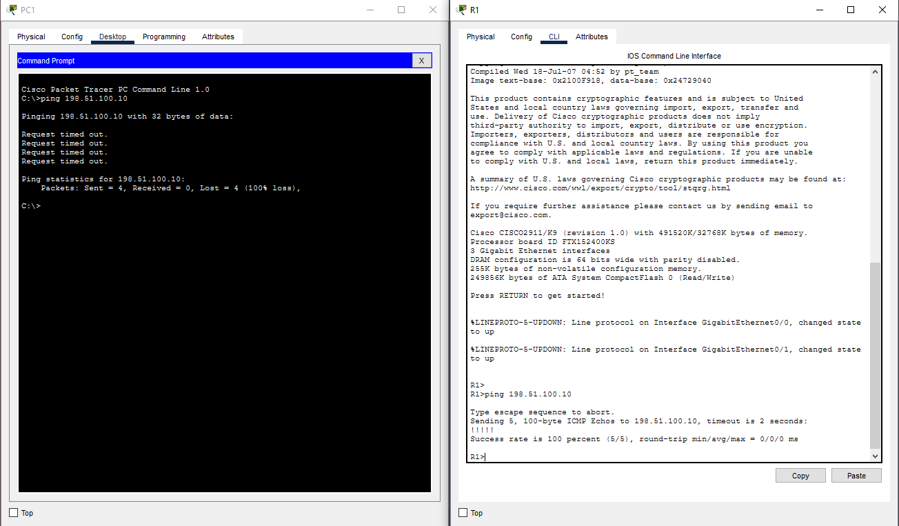
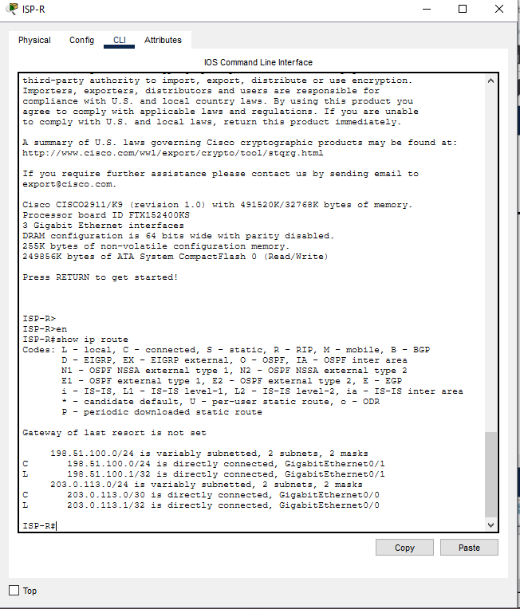
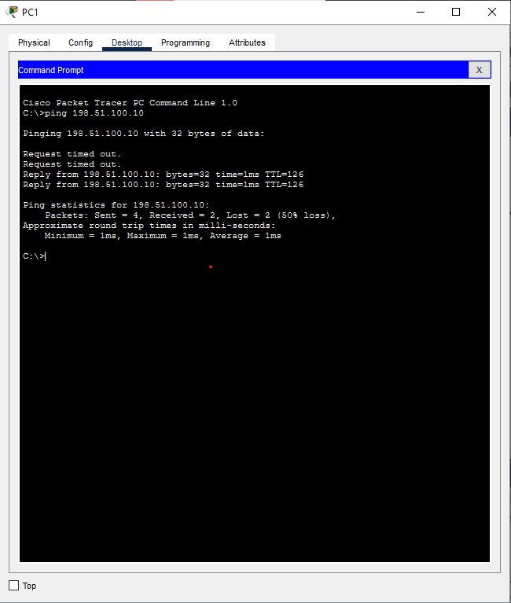

# TKT-011: Nobody in the Office Can Open Websites

| Field | Value |
|-------|-------|
| **Reported by** | Office manager |
| **Opened** | 2:15 PM |
| **Priority** | High |
| **Affected** | Entire site |
| **Layer** | 3 – Network (routing, return path) |
| **Status** | ✅ Resolved |

> 🔒 **Blind troubleshooting exercise.** Unlike TKT-001 to TKT-010, I did not
> know the fault in advance. It was run as an interview-style simulation: I asked
> for commands and diagnosed the fault only from the output I received. This write-up records my real path, including wrong
> turns. It was then reproduced in Packet Tracer for the lab files and screenshots.

## Ticket Summary

**Work log**

1. Checked the client's IP configuration and the router's routing table. Both looked correct.
2. Tried `tracert` by name; it failed because I typed the wrong hostname.
3. Confirmed the gateway responds, and that no ACLs exist on R1.
4. Pinged beyond the gateway by IP: timeouts to the ISP router and the server.
5. Compared pings from R1 (successful) and from PC1 (failed), which pointed to a return-path problem.
6. Found the missing route to `192.168.1.0/24` on ISP-R, added a static route, and verified.

**Closure note to user**
> "The provider's router had lost the route back to our office network, so replies
> from the internet couldn't reach your computers. It has been fixed and websites
> are working again."

## 1. Reported Issue

> "Since about 2 o'clock, nobody in the office can open any websites. Everything was working fine this morning."

## 2. Initial Observations

- All users are affected, so the cause is likely shared: the router, the WAN link, or beyond.
- The issue started suddenly mid-day, suggesting a change or failure rather than a client misconfiguration.

## 3. Troubleshooting Steps

| # | Action / Command | Result | Conclusion |
|---|------------------|--------|------------|
| 1 | `ipconfig` on PC1 | `192.168.1.11/24`, gateway `192.168.1.1` | Client addressing looks correct |
| 2 | `show ip route` on R1 | Connected routes + `S* 0.0.0.0/0 via 203.0.113.1` | R1 has a default route |
| 3 | `tracert ww.local.com` | "Unable to resolve target system name" | ❗ My mistake: wrong hostname (site is `www.lab.local`). Also, a name failure alone can't separate DNS from routing |
| 4 | `ipconfig /all` on PC1 | DNS `198.51.100.10`, DHCP server `192.168.1.1` | DNS and DHCP settings are correct |
| 5 | `ping 192.168.1.1` | Successful | LAN and gateway are fine |
| 6 | `show access-lists` on R1 | Nothing configured | No ACL is filtering traffic |
| 7 | `ping 203.0.113.1` (ISP router) from PC1 | Request timed out | Can't reach beyond R1 |
| 8 | `ping 192.51.100.10` from PC1 | Request timed out | ❗ Typo in the server address (correct is `198.51.100.10`) |
| 9 | `ping 203.0.113.2` (R1 WAN) from PC1 | Successful | Traffic reaches R1's WAN interface |
| 10 | `ping 203.0.113.1` and `ping 198.51.100.10` **from R1** | `.!!!!` (80%) — successful | R1 can reach the ISP router and the server |
| 11 | `show ip route` on ISP-R | No route to `192.168.1.0/24`, no default route | **ISP-R cannot send replies back to the office LAN** |

**Where I got stuck:** after step 7, I didn't know what "Request timed out"
meant compared with "Destination host unreachable" (see [TKT-008](../TKT-008-missing-route/)).
I also first thought the `.` in R1's `.!!!!` meant R1 was blocking replies, but
it is just the first packet lost while ARP resolves.

**The key comparison:**

| Ping source | Source IP | Reply goes to | ISP-R knows the way? | Result |
|-------------|-----------|---------------|----------------------|--------|
| R1 | `203.0.113.2` | Directly connected network | ✅ Yes | Success |
| PC1 | `192.168.1.11` | Network behind R1 | ❌ No route | Timeout |

**ISP-R – `show ip route`:**

```
<!-- Paste your Packet Tracer output here -->
Gateway of last resort is not set

     198.51.100.0/24 is variably subnetted, 2 subnets, 2 masks
C       198.51.100.0/24 is directly connected, GigabitEthernet0/1
L       198.51.100.1/32 is directly connected, GigabitEthernet0/1
     203.0.113.0/24 is variably subnetted, 2 subnets, 2 masks
C       203.0.113.0/30 is directly connected, GigabitEthernet0/0
L       203.0.113.1/32 is directly connected, GigabitEthernet0/0
```

**Screenshots:**

*PC1 – pings to the ISP router and the server time out:*


*R1 pings succeed, and ISP-R has no route to `192.168.1.0/24`:*


## 4. Root Cause

ISP-R was missing its static route to the office network (`192.168.1.0/24`).
Traffic **from** the office reached the server, because R1's default route was
correct, but replies addressed to `192.168.1.x` had no matching route on ISP-R
and were dropped. Because nothing could send an error back to the clients, they
saw timeouts rather than "unreachable" messages.

## 5. Resolution

Added the return route on ISP-R:

```
conf t
ip route 192.168.1.0 255.255.255.0 203.0.113.2
end
write memory
```

## 6. Verification

| Test | Result |
|------|--------|
| `show ip route` on ISP-R | `S 192.168.1.0/24 [1/0] via 203.0.113.2` ✅ |
| `ping 198.51.100.10` from PC1 | Successful ✅ |
| `tracert www.lab.local` | `192.168.1.1` → `203.0.113.1` → `198.51.100.10` ✅ |
| Browser → `http://www.lab.local` | Page loads ✅ |

*ISP-R route restored, PC1 ping and tracert to the server succeed:*


## 7. Lessons Learned

- **A ping is a round trip.** Both the path *to* the destination and the path
  *back* must work. A correct default route on R1 only proved the outbound path.
- **Timeout vs unreachable.** "Destination host unreachable" means a router answered
  with an error; "Request timed out" means nobody answered, often because the
  reply couldn't get back.
- **Change the source to split the problem.** R1 succeeded and PC1 failed for the
  same destination; the only difference was the source address, which pointed to
  the return route.
- **`.!!!!` is normal on Cisco routers.** The first packet is lost while ARP resolves.
- **Check your inputs.** Two of my early tests failed because of typos (`ww.local.com`,
  `192.51.100.10`). Copy addresses carefully, or verify a failed result before
  trusting it.
- **Real-world escalation:** In a real office, ISP-R belongs to the provider. The
  evidence from steps 9–10 (R1 reaches the server, LAN traffic gets no replies)
  would go in an escalation to the ISP.
- **Real-world NAT:** On the internet, private addresses aren't routed. R1 would
  normally use NAT/PAT to translate `192.168.1.x` to `203.0.113.2`, so the ISP
  wouldn't need a route to the LAN. This lab omits NAT for simplicity.

## Files

- [`lab-broken.pkt`](lab-broken.pkt) – lab with ISP-R's return route removed
- [`lab-fixed.pkt`](lab-fixed.pkt) – lab after the fix
- [`screenshots/`](screenshots/) – symptom, diagnosis and verification evidence
