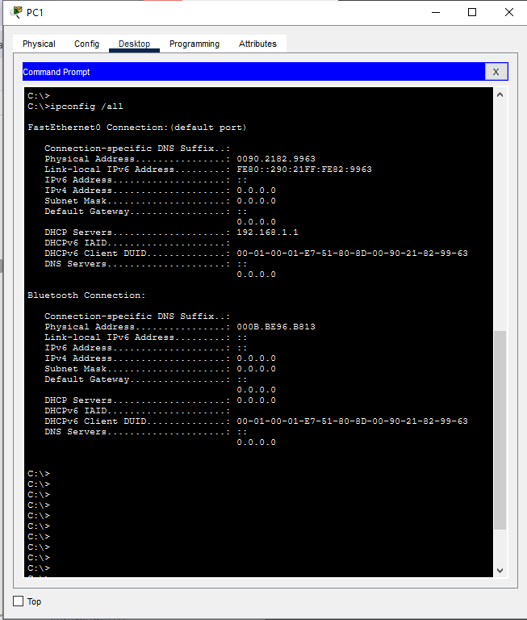
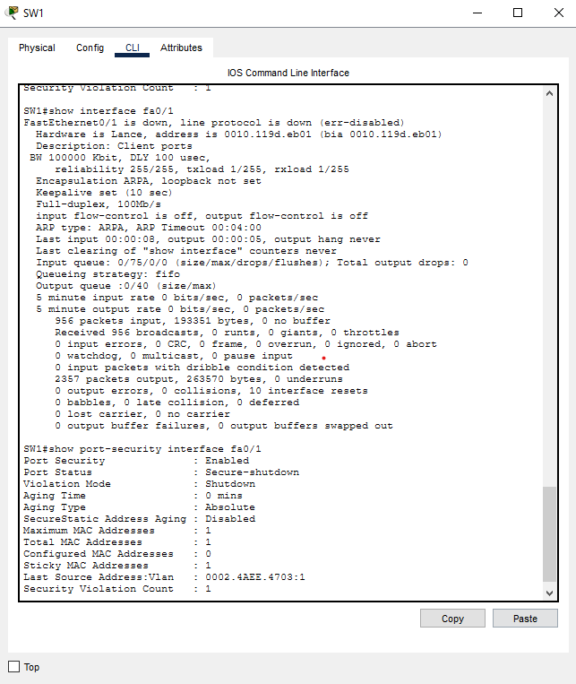
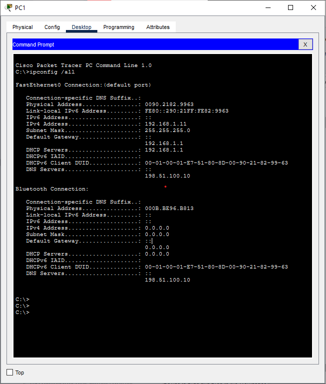

# TKT-012: User's Computer Has No Network After Returning to Desk

| Field | Value |
|-------|-------|
| **Reported by** | User at PC1 (front desk) |
| **Opened** | 9:40 AM |
| **Priority** | Medium |
| **Affected** | One user (PC1) |
| **Layer** | 2 – Data Link (switch port security) |
| **Status** | ✅ Resolved |

> 🔒 **Blind troubleshooting exercise.** I did not know the fault in advance. It was
> run as an interview-style simulation: I asked for commands and questioned the user,
> and diagnosed the fault only from what I received. This write-up records my real
> path, including wrong turns. It was then reproduced in Packet Tracer for the lab
> files and screenshots.

## Ticket Summary

**Work log**

1. Asked the user for their computer details and had them run `ipconfig /all`: no IPv4 address and no IPv6 link-local address.
2. Checked DHCP bindings and ACLs on R1. DHCP was working; no ACLs.
3. Realised the missing link-local address meant PC1's interface was down, so DHCP was never reached.
4. User confirmed the cable was plugged in but the port light was off. SW1 showed Fa0/1 `down`.
5. `show interface fa0/1` revealed the port was **err-disabled**.
6. Port-security status and switch logs showed a violation by an unknown MAC address at 8:47 AM.
7. The user confirmed they had plugged a personal laptop into the desk cable at that time.
8. Reset the port (`shutdown` / `no shutdown`) and verified PC1 was back online.

**Closure note to user**
> "The network port at your desk only accepts your work computer. When your personal
> laptop was plugged in, the switch blocked the port for security. I've reset it and
> your computer is working again. Please don't connect personal devices to the wired
> network; use the guest Wi-Fi instead."

## 1. Reported Issue

> "My computer has no network since I came back to my desk this morning. Everyone else seems fine. I didn't change anything!"

## 2. Initial Observations

- Only PC1 is affected, so the cause is likely on PC1's own connection.
- The user states nothing changed, but users don't always connect their actions to the problem.

## 3. Troubleshooting Steps

| # | Action / Command | Result | Conclusion |
|---|------------------|--------|------------|
| 1 | Asked user for computer name / IP | "PC1"; user didn't know the IP | Walked the user through running the command |
| 2 | `ipconfig /all` on PC1 | IPv4 `0.0.0.0`, link-local IPv6 `::` (empty), MAC `0090.2182.9963` | No address at all |
| 3 | `show ip dhcp binding` on R1 | PC1's MAC still has a binding; PC2 has a lease | DHCP server is working |
| 4 | `show access-lists` on R1 | None | No filtering |
| 5 | Re-read step 2 | No `FE80::` link-local address | ❗ I first thought DHCP wasn't responding, then that a static IP was needed. But a missing link-local address means **the interface is down**, so DHCP requests never left PC1 |
| 6 | Asked user about cable and link light | Cable plugged in, **no light** on PC port | Physical link is not up |
| 7 | `show ip interface brief` on SW1 | Fa0/1 `down / down` | Port is down, but this doesn't say why |
| 8 | `show interface fa0/1` on SW1 | `line protocol is down (err-disabled)` | The switch shut the port down on purpose |
| 9 | `show port-security interface fa0/1` | `Secure-shutdown`, max 1 MAC, sticky MAC learned, last source `0002.4AEE.4703`, violation count 1 | A port-security violation disabled the port |
| 10 | `show logging` on SW1 | `PSECURE_VIOLATION ... caused by MAC address 0002.4AEE.4703` at **08:47** | Exact time and the offending MAC |
| 11 | Compared MACs | `0002.4AEE.4703` ≠ PC1's `0090.2182.9963` | A different device was connected to PC1's port |
| 12 | Asked the user about 8:47 AM | User had plugged a **personal laptop** into the desk cable to download something | Root cause confirmed |

**PC1 – `ipconfig /all`:**

```
C:\>ipconfig /all

FastEthernet0 Connection:(default port)

   Connection-specific DNS Suffix..: 
   Physical Address................: 0090.2182.9963
   Link-local IPv6 Address.........: ::
   IPv6 Address....................: ::
   IPv4 Address....................: 0.0.0.0
   Subnet Mask.....................: 0.0.0.0
   Default Gateway.................: ::
                                     0.0.0.0
   DHCP Servers....................: 192.168.1.1
   DNS Servers.....................: ::
                                     0.0.0.0
```

**SW1 – `show interface fa0/1` (first line):**

```
SW1#show interface fa0/1
FastEthernet0/1 is down, line protocol is down (err-disabled)
  Hardware is Lance, address is 0010.119d.eb01 (bia 0010.119d.eb01)
  Description: Client ports
  ...
     0 output errors, 0 collisions, 10 interface resets
```

**SW1 – `show port-security interface fa0/1`:**

```
SW1#show port-security interface fa0/1
Port Security              : Enabled
Port Status                : Secure-shutdown
Violation Mode             : Shutdown
Aging Time                 : 0 mins
Aging Type                 : Absolute
SecureStatic Address Aging : Disabled
Maximum MAC Addresses      : 1
Total MAC Addresses        : 1
Configured MAC Addresses   : 0
Sticky MAC Addresses       : 1
Last Source Address:Vlan   : 0002.4AEE.4703:1
Security Violation Count   : 1
```

**SW1 – sticky MAC saved in the running config:**

```
interface FastEthernet0/1
 description Client ports
 switchport mode access
 switchport port-security
 switchport port-security mac-address sticky 
 switchport port-security mac-address sticky 0090.2182.9963
```

**Screenshots:**

*PC1 – no IPv4 address and no link-local address:*


*SW1 – Fa0/1 err-disabled and port-security violation details:*


## 4. Root Cause

Port security on SW1 Fa0/1 allows only one MAC address and had learned PC1's MAC
(`0090.2182.9963`) as a sticky address. At 08:47, the user unplugged PC1 and
connected a personal laptop (`0002.4AEE.4703`). The switch treated the new MAC as a
security violation and, with violation mode `shutdown`, put the port into the
**err-disabled** state. Reconnecting PC1 did not restore the port, because an
err-disabled port stays down until it is reset.

## 5. Resolution

Reset the port on SW1:

```
conf t
interface fa0/1
 shutdown
 no shutdown
end
```

PC1's MAC remained the sticky address, so PC1 was accepted immediately. The user was
informed of the policy on personal devices.

## 6. Verification

| Test | Result |
|------|--------|
| `show port-security interface fa0/1` | `Secure-up`, violation count 0, last source = PC1's MAC ✅ |
| `show interface fa0/1` | `up, line protocol is up` ✅ |
| `ipconfig` on PC1 | Link-local `FE80::...`, IPv4 `192.168.1.11`, gateway `192.168.1.1` ✅ |
| `ping 192.168.1.1` and browser → `http://www.lab.local` | Successful ✅ |

*Port restored and PC1 back online:*


## 7. Lessons Learned

- **An empty link-local address means the interface is down.** A PC creates its
  `FE80::` address by itself as soon as the link comes up. `0.0.0.0` *with* `FE80::`
  points to DHCP or VLAN ([TKT-002](../TKT-002-wrong-vlan/)); `0.0.0.0` *without* it
  points to the physical link or switch port.
- **"Down" isn't a reason.** `show ip interface brief` only said `down`;
  `show interface` revealed `err-disabled`, which means the switch disabled the port deliberately.
- **err-disabled has a cause; find it.** `show port-security interface` and
  `show logging` gave the violating MAC and the exact time.
- **Use timestamps when questioning users.** "Did you change anything?" got "no";
  "What happened at 8:47?" got the real answer.
- **An err-disabled port needs a manual reset** (`shutdown` / `no shutdown`), unless
  `errdisable recovery cause psecure-violation` is configured to recover it automatically
  after a timer. Some organisations prefer manual recovery so IT sees every violation.
- **It's also a policy issue.** Users need to know personal devices aren't allowed on
  wired ports, and where to connect them instead.

## Lab Setup (to reproduce)

Port security configured on SW1 Fa0/1 in the base lab:

```
conf t
interface fa0/1
 switchport mode access
 switchport port-security
 switchport port-security maximum 1
 switchport port-security mac-address sticky
 switchport port-security violation shutdown
end
```

PC1 generated traffic so its MAC was learned as sticky, then a laptop was
connected to Fa0/1 in place of PC1 to trigger the violation, and PC1 was reconnected.

> ⚠️ **Packet Tracer note:** the err-disabled state is not saved in the `.pkt` file.
> When `lab-broken.pkt` is reopened, the port-security configuration and PC1's sticky
> MAC are still there, but Fa0/1 starts as `Secure-up`. To reproduce the fault, connect
> the Laptop to Fa0/1 (DHCP or a ping generates traffic), then reconnect PC1.
> The screenshots in this ticket were taken while the fault was active.

## Files

- [`lab-broken.pkt`](lab-broken.pkt) – lab with port security configured and the Laptop ready to trigger the violation (see note above)
- [`lab-fixed.pkt`](lab-fixed.pkt) – lab after the port reset
- [`screenshots/`](screenshots/) – symptom, diagnosis and verification evidence
