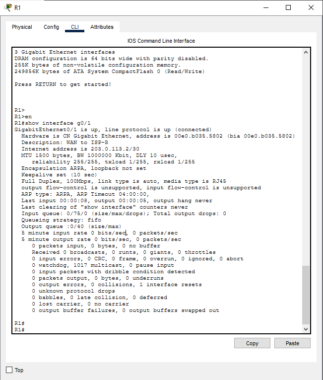
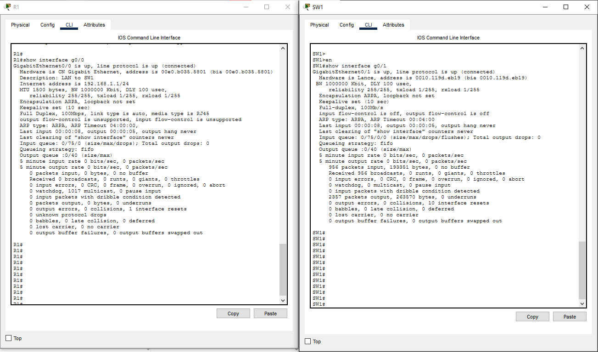
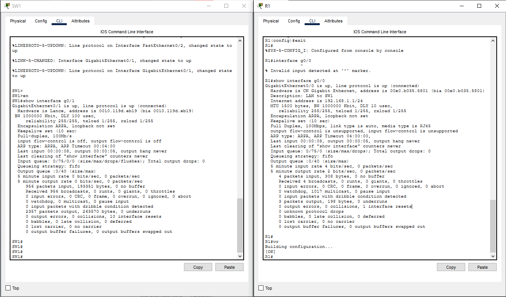

# TKT-013: Internet Very Slow for Everyone, Large Downloads Fail

| Field | Value |
|-------|-------|
| **Reported by** | Office manager |
| **Opened** | 10:05 AM |
| **Priority** | Medium |
| **Affected** | Entire site (performance, not outage) |
| **Layer** | 1–2 (speed/duplex mismatch) |
| **Status** | ✅ Resolved |

> 🔒 **Blind troubleshooting exercise.** I did not know the fault in advance. It was
> run as an interview-style simulation: I asked for commands and questioned the users,
> and diagnosed the fault only from what I received. This write-up records my real
> path, including wrong turns. It was then reproduced in Packet Tracer for the lab
> files and screenshots.

## Ticket Summary

**Work log**

1. Checked how many devices were on the network (DHCP bindings, switch MAC table): only 2 clients.
2. Checked R1's WAN interface: nearly idle (≈40 kbps, load 1/255), no errors, so not congestion.
3. Considered heavy usage by the users; ruled out by the low traffic figures and by confirming with the office manager.
4. Checked both ends of the shared SW1 ↔ R1 link: **R1 full duplex, SW1 half duplex**, with CRC errors and runts on R1 and collisions and late collisions on SW1.
5. Found R1 G0/0 hard-coded to `speed 100` / `duplex full` by a technician the previous afternoon.
6. Returned R1 G0/0 to auto-negotiation, cleared counters, and verified the link was full duplex with no new errors.

**Closure note to user**
> "A setting changed on the router yesterday caused a mismatch with the office switch,
> which corrupted traffic and made everything slow. It has been corrected; pages and
> downloads should be fast again."

## 1. Reported Issue

> "Since yesterday afternoon, the internet is really slow for everyone. Pages take forever to load, and when I download big files they keep failing halfway. It's not completely down, just painfully slow."

## 2. Initial Observations

- Everyone is affected, so the cause is probably in a shared part of the path.
- The network is **slow, not down**: a performance problem rather than a reachability problem.
- Large downloads **fail**, not just slow down, which suggests damaged or lost packets.
- It started "yesterday afternoon", so a recent change is a suspect.

## 3. Troubleshooting Steps

| # | Action / Command | Result | Conclusion |
|---|------------------|--------|------------|
| 1 | `show ip dhcp binding` on R1 | 2 clients (PC1, PC2) | Small number of devices |
| 2 | `show mac address-table` on SW1 | PC1 on Fa0/1, PC2 on Fa0/2, R1 on Gi0/1 | No unexpected devices |
| 3 | `show interfaces g0/1` on R1 (WAN) | ≈41 kbps, 12 pkts/s, load 1/255, **0 errors** | WAN link is healthy and almost idle |
| 4 | Hypothesis: users overloading the link | ❗ Rejected: traffic far too low, and the office manager confirmed only email and one download | Not congestion |
| 5 | Mapped the path PC → SW1 → R1 G0/0 → R1 G0/1 → ISP | Only R1 G0/1 had been checked | ❗ I first suggested R1 → ISP, which was already checked. The shared SW1 ↔ R1 link was next |
| 6 | `show interfaces g0/0` on R1 | `Full-duplex, 100Mb/s`; **3121 CRC, 1702 runts, 4823 input errors** | R1 receives damaged frames |
| 7 | `show interfaces gi0/1` on SW1 | `Half-duplex, 100Mb/s, link type is auto`; **5390 collisions, 2214 late collisions** | The two ends disagree on duplex |
| 8 | `show running-config interface g0/0` on R1 | `speed 100`, `duplex full` (hard-coded) | Auto-negotiation disabled on R1's side |
| 9 | Asked the IT team about changes | A technician hard-coded R1 G0/0 yesterday afternoon | Matches the start of the problem |

**R1 – `show interfaces g0/0` (key lines):**

```
<!-- Paste your Packet Tracer output here -->
  Full-duplex, 100Mb/s, media type is RJ45
     Received 3120 broadcasts, 1702 runts, 0 giants, 0 throttles
     4823 input errors, 3121 CRC, 0 frame, 0 overrun, 0 ignored, 0 abort
```

**SW1 – `show interfaces gi0/1` (key lines):**

```
<!-- Paste your Packet Tracer output here -->
  Half-duplex, 100Mb/s, link type is auto, media type is 10/100/1000BaseTX
     0 output errors, 5390 collisions, 1 interface resets
     0 babbles, 2214 late collision, 0 deferred
```

**R1 – `show running-config interface g0/0`:**

```
<!-- Paste your Packet Tracer output here -->
interface GigabitEthernet0/0
 description LAN to SW1
 ip address 192.168.1.1 255.255.255.0
 duplex full
 speed 100
```

**Screenshots:**

*R1's WAN interface: low traffic, no errors (ruling out congestion):*


*R1 G0/0 full duplex with CRC errors vs SW1 Gi0/1 half duplex with collisions:*


## 4. Root Cause

R1's LAN interface (G0/0) was manually set to `speed 100` and `duplex full`, which
disables auto-negotiation on that side. SW1's Gi0/1 was still on auto: it could
detect the speed (100 Mb/s) but not the duplex, so it fell back to **half duplex**.

| Side | Duplex | What it sees | Why |
|------|--------|--------------|-----|
| SW1 Gi0/1 | Half | Collisions, **late collisions** | Expects to take turns; R1 transmits at the same time |
| R1 G0/0 | Full | **CRC errors, runts** | Receives frames SW1 abandoned mid-transmission |

The corrupted frames had to be retransmitted, which made browsing slow and caused
large downloads to fail.

## 5. Resolution

Returned R1 G0/0 to auto-negotiation so both ends agree, then cleared the counters
to confirm no new errors:

```
conf t
interface g0/0
 speed auto
 duplex auto
end
clear counters g0/0
```

On SW1: `clear counters gi0/1`.

## 6. Verification

| Test | Result |
|------|--------|
| `show interfaces g0/0` on R1 | Full duplex, 0 CRC / input errors after clearing ✅ |
| `show interfaces gi0/1` on SW1 | Full duplex, 0 collisions / late collisions ✅ |
| Large download from PC1 | Completes quickly ✅ |
| Browser → `http://www.lab.local` | Loads normally ✅ |

*Both sides full duplex, counters clean after the fix:*


## 7. Lessons Learned

- **"Slow" is not "down."** For performance problems, check the **error counters**
  (CRC, runts, collisions) early, not just reachability.
- **Test your hypothesis against the data.** I suspected users were overloading the
  link, but the interface showed it was nearly idle, which ruled congestion out.
- **Check both ends of a link.** Each side alone looked "up/up"; only comparing them
  revealed the duplex mismatch.
- **Classic duplex mismatch signature:** late collisions on the half-duplex side,
  CRC errors and runts on the full-duplex side.
- **Auto/auto or the same fixed setting on both ends, never mixed.** Hard-coding one
  side disables negotiation and forces the other side to half duplex.
- **Fix the cause, not the symptom.** Forcing SW1 to full duplex would also work, but
  undoing the bad change on R1 restored the intended configuration.
- **Recent changes matter.** The problem began right after a manual change; change
  records and asking "what changed?" shortened the search.

## Lab Setup (to reproduce)

Fault introduced on R1 in the base lab:

```
conf t
interface g0/0
 speed 100
 duplex full
end
```

SW1 Gi0/1 left on auto. Note: Packet Tracer may not generate collision and CRC
counters as realistically as real hardware; the duplex values in
`show interfaces` and any `%CDP-4-DUPLEX_MISMATCH` messages are the main evidence there.

## Files

- [`lab-broken.pkt`](lab-broken.pkt) – lab with R1 G0/0 hard-coded to 100/full
- [`lab-fixed.pkt`](lab-fixed.pkt) – lab after returning to auto-negotiation
- [`screenshots/`](screenshots/) – symptom, diagnosis and verification evidence
