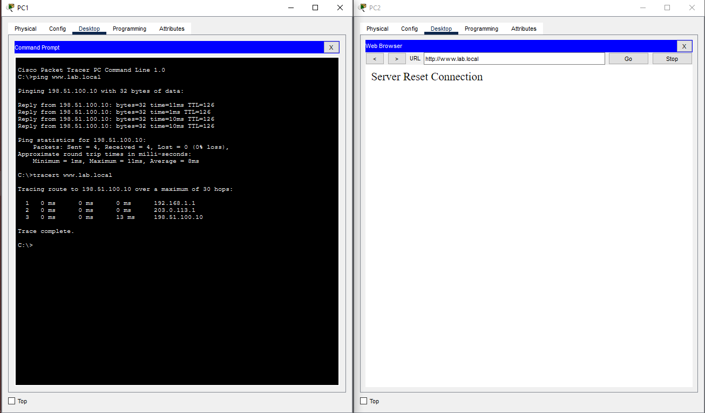
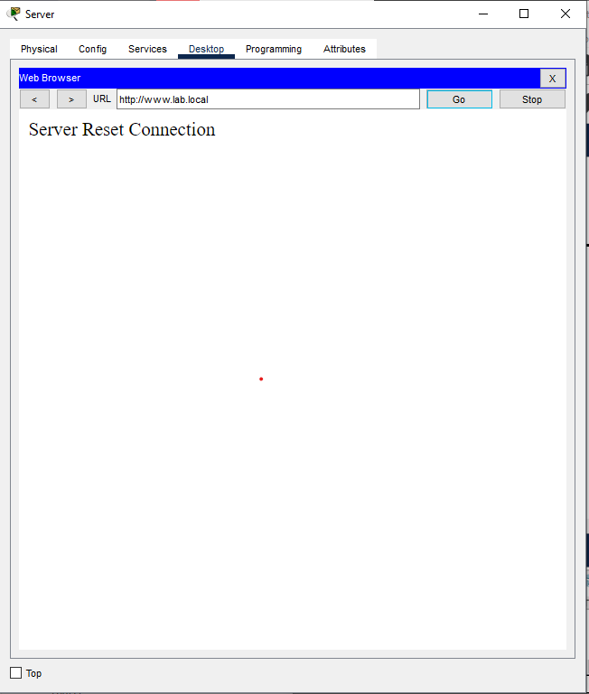
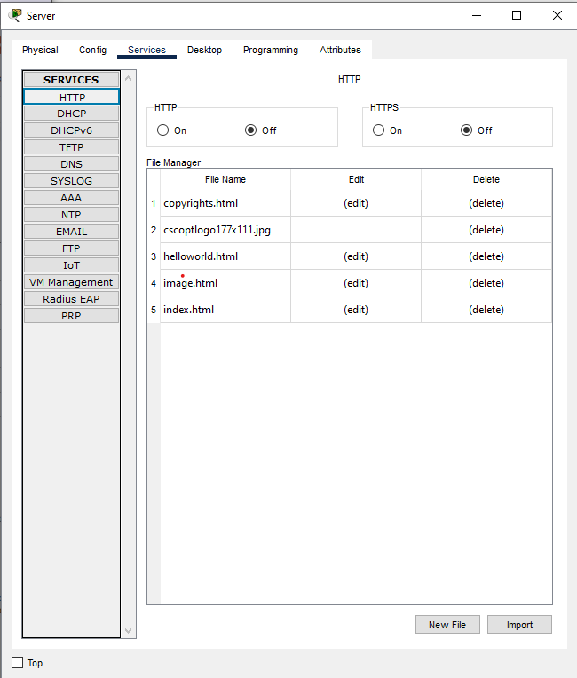
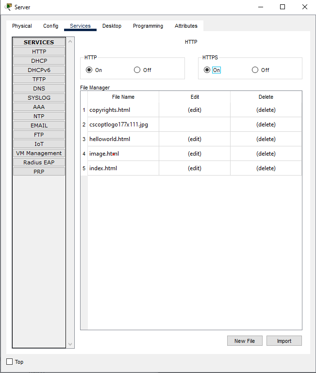
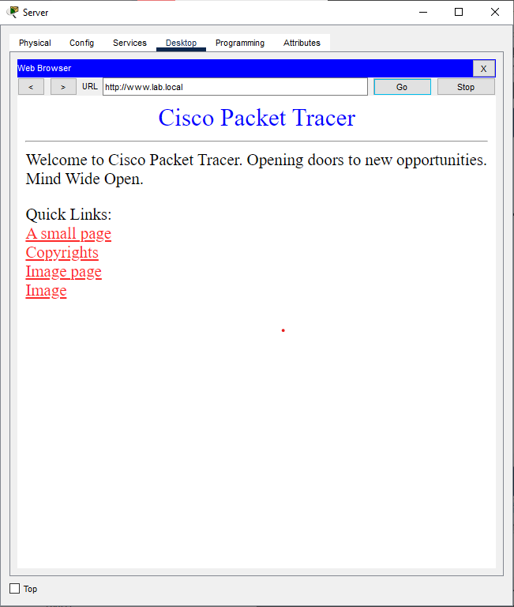

# TKT-014: Company Website Unreachable, but the Server Responds to Ping

| Field | Value |
|-------|-------|
| **Reported by** | Office manager (and external customers) |
| **Opened** | 11:20 AM |
| **Priority** | High |
| **Affected** | Everyone accessing `www.lab.local`, internal and external |
| **Layer** | 7 – Application (web service) |
| **Status** | ✅ Resolved |

> 🔒 **Blind troubleshooting exercise.** I did not know the fault in advance. It was
> run as an interview-style simulation: I asked for commands and questioned the users,
> and diagnosed the fault only from what I received. This write-up records my real
> path. It was then reproduced in Packet Tracer for the lab files and screenshots.

## Ticket Summary

**Work log**

1. Pinged and traced `www.lab.local` from PC1: the name resolved and the server replied over the full path.
2. Checked R1 for ACLs that could block web traffic while allowing ping: none.
3. Checked the server's IP configuration: correct.
4. Opened the website from the server itself: it still failed, so the network was ruled out.
5. Found the HTTP and HTTPS services stopped on the server (nothing listening on port 80), after a reboot the night before.
6. Started the web services and verified the site loads for internal users and customers.

**Closure note to user**
> "The web service on the server didn't restart after last night's maintenance reboot.
> It has been started again and set to start automatically. The website is back online
> for staff and customers."

## 1. Reported Issue

> "Our company website, www.lab.local, won't open on any of our computers. Customers are calling to say they can't reach it either! Everything else seems fine."

## 2. Initial Observations

- Both internal users **and external customers** are affected, so the problem is
  probably not the office network. It is more likely at the server.
- "Everything else seems fine" suggests only one service is affected.

## 3. Troubleshooting Steps

| # | Action / Command | Result | Conclusion |
|---|------------------|--------|------------|
| 1 | `ping www.lab.local` from PC1 | Resolved to `198.51.100.10`, 4/4 replies | **DNS works**, and the server is up and reachable |
| 2 | `tracert www.lab.local` from PC1 | `192.168.1.1` → `203.0.113.1` → `198.51.100.10` | **Routing works** end to end |
| 3 | `show access-lists` on R1 | None | No ACL blocking web traffic while allowing ping |
| 4 | `ipconfig /all` on Server | `198.51.100.10/24`, gateway `198.51.100.1`, DNS `198.51.100.10` | Server addressing is correct |
| 5 | Browser on **the server itself** → `http://www.lab.local` | **Server Reset Connection** | Fails without crossing any network: **the problem is on the server**. A reset means the server answered but nothing accepted the connection on port 80 |
| 6 | Checked server services | HTTP **Off**, HTTPS **Off** | The web service is not running |
| 7 | Asked the IT team about changes | Server rebooted last night for updates | Service did not start after the reboot |

**PC1 – `ping` and `tracert www.lab.local`:**

```
<!-- Paste your Packet Tracer output here -->
```

**Server – browser to `http://www.lab.local`:**

```
URL: http://www.lab.local

Server Reset Connection
```

The server replied with a TCP reset (RST): the host is up, but no service is
listening on port 80. On a real browser this appears as "connection refused"
(e.g. `ERR_CONNECTION_REFUSED`).

**Real-server equivalent (for reference):**

```
C:\>sc query W3SVC
        STATE              : 1  STOPPED

C:\>netstat -an | findstr :80
C:\>
```

**Screenshots:**

*PC1 – ping and tracert to `www.lab.local` succeed, but the browser fails:*


*Server – browser fails locally, and the HTTP/HTTPS services are Off:*




## 4. Root Cause

The HTTP and HTTPS services on the web server were **stopped**. They did not start
again after the server was rebooted for updates the night before. With nothing
listening on TCP port 80, every web request failed, from the office, from customers,
and from the server itself.

**Why ping still worked:** ping uses ICMP, which the server's operating system answers
directly at Layer 3. A web page needs the HTTP application listening on TCP port 80
(Layer 7). The server was up and reachable; only the application was down.

## 5. Resolution

- **In Packet Tracer:** Server → Services → HTTP **On**, HTTPS **On**.
- **On a real server:** start the web service (e.g. `net start W3SVC` on Windows IIS,
  or `systemctl start nginx` on Linux) and set it to start automatically at boot
  (`sc config W3SVC start= auto`, or `systemctl enable nginx`).

## 6. Verification

| Test | Result |
|------|--------|
| Browser on Server → `http://www.lab.local` | Page loads ✅ |
| Browser on PC1 and PC2 → `http://www.lab.local` | Page loads ✅ |
| Real-server check: `netstat -an \| findstr :80` | `0.0.0.0:80 LISTENING` ✅ |
| Customers | Confirmed the site is reachable ✅ |

*Web services On, and the site loads from PC1:*



## 7. Lessons Learned

- **Ping success doesn't mean the application works.** ICMP proves the host is up;
  a website needs its service listening on the right port.
- **Read the browser error.** "Server Reset Connection" (connection refused) means the
  server is reachable and actively rejecting the connection because nothing is
  listening on the port. A timeout would instead suggest traffic being dropped or
  never arriving, such as a firewall or a routing problem.
- **Prove each layer in one step.** A successful `ping` by name confirmed DNS and
  routing together, which narrowed the search immediately.
- **Test from the server itself.** A local request removes the network entirely; if
  it fails there, the problem is the application or the server's configuration.
- **Scope gives clues.** Internal users *and* external customers failing pointed away
  from the office network and toward the server.
- **Reboots can break services.** After maintenance, verify that critical services
  are running, and make sure they are set to start automatically.
- **Prevention:** Monitor the service itself (e.g. an HTTP check on port 80), not just
  ping, so a stopped web service raises an alert immediately.

## Lab Setup (to reproduce)

In the base lab, on the Server: Services → HTTP **Off** and HTTPS **Off**.

## Files

- [`lab-broken.pkt`](lab-broken.pkt) – lab with the web services stopped
- [`lab-fixed.pkt`](lab-fixed.pkt) – lab with the web services running
- [`screenshots/`](screenshots/) – symptom, diagnosis and verification evidence
