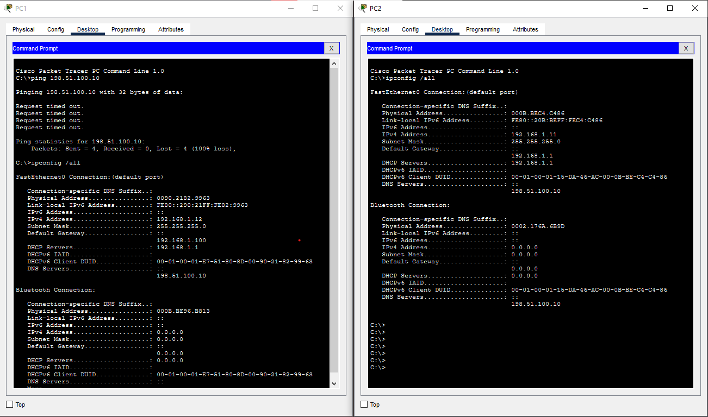
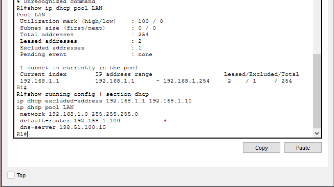
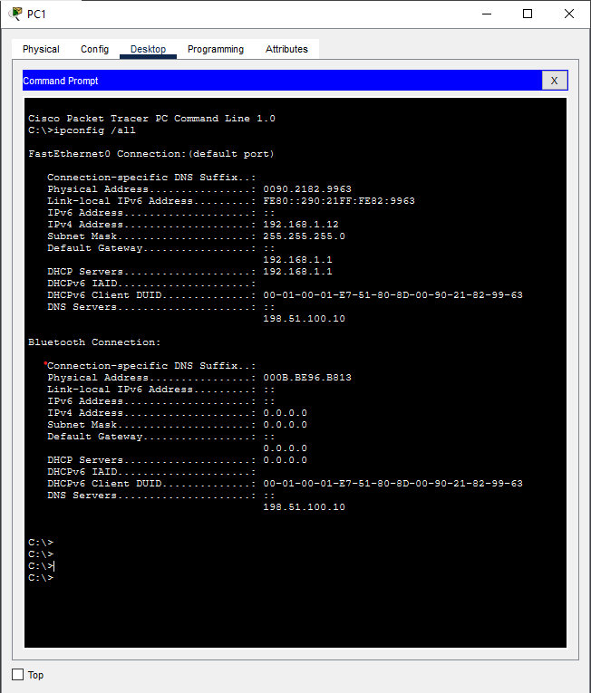

# TKT-015: One User Has No Internet, Coworker on the Same Network Is Fine

| Field | Value |
|-------|-------|
| **Reported by** | User at PC1 |
| **Opened** | 9:15 AM |
| **Priority** | Medium |
| **Affected** | PC1 (and any client renewing its DHCP lease) |
| **Layer** | 3 / 7 – Wrong default gateway handed out by DHCP |
| **Status** | ✅ Resolved |

> 🔒 **Blind troubleshooting exercise.** I did not know the fault in advance. It was
> run as an interview-style simulation: I asked for commands and questioned the users,
> and diagnosed the fault only from what I received. This write-up records my real
> path, including wrong turns. It was then reproduced in Packet Tracer for the lab
> files and screenshots.

## Ticket Summary

**Work log**

1. Remotely ran `ipconfig /all` on PC1: default gateway `192.168.1.100` instead of `192.168.1.1`, received from the DHCP server `192.168.1.1`.
2. Checked DHCP bindings on R1 and VLANs on SW1. Both PCs in VLAN 1; lease times showed PC1 renewed this morning and PC2 yesterday afternoon.
3. Renewed PC1's lease: received the same wrong gateway, which confirmed DHCP itself was handing it out.
4. `show running-config | section dhcp` on R1 showed `default-router 192.168.1.100`, changed the previous evening for a firewall not yet installed.
5. Set the pool's default router back to `192.168.1.1`, renewed both clients, and verified internet access.

**Closure note to user**
> "A setting on the office router was changed last night and gave your computer the
> wrong gateway when it reconnected this morning. Your coworker hadn't reconnected yet,
> so they weren't affected. It's fixed for everyone now."

## 1. Reported Issue

> "My internet stopped working this morning, but my coworker at the next desk (PC2) is fine. We're on the same network, so I don't understand!"

## 2. Initial Observations

- Only PC1 is affected; PC2 on the same switch and VLAN works.
- Same network but different behaviour suggests a difference in **client configuration**.

## 3. Troubleshooting Steps

| # | Action / Command | Result | Conclusion |
|---|------------------|--------|------------|
| 1 | `ipconfig /all` on PC1 (remote) | Gateway `192.168.1.100`; DHCP server `192.168.1.1` | Wrong gateway, and it came **from DHCP**, not a manual setting (unlike [TKT-005](../TKT-005-wrong-gateway/)) |
| 2 | `show vlan brief` on SW1 | Fa0/1 and Fa0/2 both in VLAN 1 | VLAN is not the issue |
| 3 | `show ip dhcp binding` on R1 | PC1 lease expires Nov 27 08:02; PC2 lease expires Nov 26 16:47 (1-day leases) | PC1 got its lease **this morning**; PC2 **yesterday afternoon** |
| 4 | Interpreted the lease times | ❗ I first read them backwards and thought PC1 had the *old* parameters | Correct reading: PC1 has the **new** (wrong) parameters; PC2 still has the old (correct) ones |
| 5 | `ipconfig /release` + `/renew` on PC1 | Same gateway `192.168.1.100` again | The DHCP server is actively handing out the wrong gateway |
| 6 | `show ip dhcp pool` and `show running-config \| include dhcp` on R1 | Pool usage only; no gateway shown | ❗ Neither command displays `default-router`; the line doesn't contain the word "dhcp" |
| 7 | `show running-config \| section dhcp` on R1 | `default-router 192.168.1.100` | **Root cause confirmed** |
| 8 | Asked the IT team about changes | Pool updated the previous evening for a planned firewall at `.100`, not yet installed | Explains the timing |

**PC1 – `ipconfig /all`:**

```
<!-- Paste your Packet Tracer output here -->
   IPv4 Address....................: 192.168.1.11
   Subnet Mask.....................: 255.255.255.0
   Default Gateway.................: 192.168.1.100
   DHCP Servers....................: 192.168.1.1
```

**R1 – `show running-config | section dhcp`:**

```
<!-- Paste your Packet Tracer output here -->
ip dhcp excluded-address 192.168.1.1 192.168.1.10
ip dhcp pool LAN
 network 192.168.1.0 255.255.255.0
 default-router 192.168.1.100
 dns-server 198.51.100.10
```

**Screenshots:**

*PC1 – DHCP-assigned gateway `192.168.1.100`, and PC2 still showing `192.168.1.1`:*


*R1 – DHCP pool configured with `default-router 192.168.1.100`:*


## 4. Root Cause

The previous evening, the DHCP pool's default router on R1 was changed from
`192.168.1.1` to `192.168.1.100` in preparation for a new firewall that had not yet
been installed. No device exists at `.100`.

DHCP clients only receive new options when they obtain or renew a lease. PC1 renewed
at 08:02 and received the wrong gateway, so it lost internet access. PC2's lease was
from the previous afternoon, before the change, so it still had the correct gateway
and would have broken at its next renewal.

## 5. Resolution

Set the correct default router in the DHCP pool. A new `default-router` line replaces
the old one:

```
conf t
ip dhcp pool LAN
 default-router 192.168.1.1
end
write memory
```

Then renewed the lease on both clients (`ipconfig /release`, `ipconfig /renew`).

## 6. Verification

| Test | Result |
|------|--------|
| `show running-config \| section dhcp` on R1 | `default-router 192.168.1.1` ✅ |
| `ipconfig` on PC1 and PC2 | Gateway `192.168.1.1` ✅ |
| `ping 198.51.100.10` from PC1 | Successful ✅ |
| Browser → `http://www.lab.local` | Page loads ✅ |

*Pool corrected, PC1 renewed with gateway `192.168.1.1` and internet restored:*


## 7. Lessons Learned

- **Check where a setting comes from.** The `DHCP Servers` line showed the wrong gateway
  was assigned by DHCP, so fixing PC1 by hand would only hide the real problem.
- **Lease timing explains "it works for some people."** A bad DHCP change spreads
  gradually: clients are affected only when they renew, so recently restarted machines
  break first.
- **Read lease times carefully.** With 1-day leases, *expiration − 1 day = when the
  lease was obtained*. I initially read them backwards.
- **Know which command shows what.** `show ip dhcp pool` shows usage, not options;
  `| include dhcp` misses lines like `default-router`. `| section dhcp` shows the
  whole pool configuration.
- **Replace, don't just remove.** `no default-router` would leave clients with *no*
  gateway. Entering the correct `default-router` replaces the wrong value.
- **Change management:** a live setting was changed for equipment that wasn't installed
  yet. Gateway changes should happen only when the new device is in place and tested,
  during a planned change window.

## Lab Setup (to reproduce)

Fault introduced on R1 in the base lab:

```
conf t
ip dhcp pool LAN
 default-router 192.168.1.100
end
```

Renew PC1 only (Static → DHCP); leave PC2 with its existing lease to show the
difference between the two clients.

## Files

- [`lab-broken.pkt`](lab-broken.pkt) – lab with the wrong default router in the DHCP pool
- [`lab-fixed.pkt`](lab-fixed.pkt) – lab after the fix
- [`screenshots/`](screenshots/) – symptom, diagnosis and verification evidence
